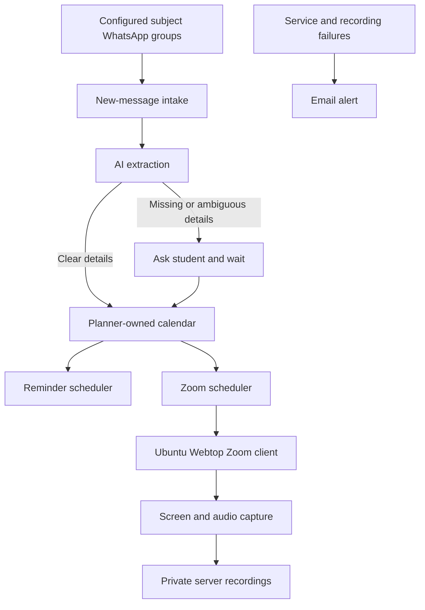

# Student Planner for WhatsApp Classes and Assignments

* **Author:** piragenth-satkunananthan
* **Status:** Draft
* **Date:** 2026-11-07

--------------------------------------------------------------------------------

## Overview

The Student Planner is intended to help one student keep up with classes and assignments announced across separate subject WhatsApp groups. It turns lecturer posts into a shared calendar with reminders and aims to join and screen/audio-record Zoom classes on the user's server. The student should be able to check the planner from an Android phone or Arch Linux desktop. Unattended Zoom joining, admission, and detecting when the host ends a meeting still need to be proven in a test meeting before recording can be treated as dependable.

## The Problem

Lecturers post assignment instructions and Zoom links in subject WhatsApp groups. Important details can be missed among group messages, and manually entering every deadline and class into a calendar adds work and can still fail when a post is overlooked. The student needs one place to track those assignments and classes, receive reminders, and capture permitted lectures when they cannot join on time. When a post leaves an important date or class time unclear, the planner should ask the student rather than guess.

## Goals

* Create calendar entries from new, relevant lecturer posts in the student's configured subject groups, including assignment details and Zoom class links.
* Use AI to interpret assignment and class instructions, and ask the student when required information is missing or ambiguous.
* Treat a clear assignment date with no stated time as due at 11:59 PM Sri Lanka time. Remind the student at 9:00 AM Sri Lanka time on the day before and on the due date.
* Remind the student about Zoom classes at 9:00 AM Sri Lanka time the day before and one hour before the class. Ask for the class time when the post does not provide it.
* For a scheduled class, aim to join five minutes before it starts, wait up to 20 minutes for the meeting to open, capture screen and audio, and stop when the host ends the meeting. Report failures so the student can decide what to do next.
* Prove the message intake and unattended Zoom workflow with a test group and host-controlled test meeting before relying on it for live classes.

## Non-Goals

* Support multiple users or overlapping Zoom classes.
* Send messages or replies to subject WhatsApp groups.
* Guess unclear assignment dates or Zoom class times.
* Replace a full learning-management system.
* Support multiple WhatsApp automation libraries in the initial version.

## Technical Plan (Architecture)

The service runs on the user's server and owns the planner calendar. A calendar view in the service makes the assignments and classes available from the user's Android phone and Arch Linux desktop. Each calendar item keeps a reference to the source WhatsApp message so the student can check where its details came from.

### Message intake and planning

* A WhatsApp intake client watches only newly arriving posts in configured subject groups. A one-group pilot chooses either Baileys or whatsapp-web.js based on message delivery and session recovery in the user's environment.
* An AI extraction step identifies assignment instructions, due dates, Zoom links, and class times from relevant lecturer posts. It does not import unrelated group history.
* Clear information becomes a planner item. If required details are missing or ambiguous, the item waits for the student's answer; the service does not create a scheduled class from a guessed time. Raw message text is retained only while clarification is pending, then the structured item and source reference remain.
* The planner calendar stores the source item and its reminder state. Assignment and class reminders use the Sri Lanka time rules in the Goals section and remain deduplicated when the service restarts or a post is received again.

### Zoom scheduling and capture

* The Zoom scheduler watches confirmed class items and starts the candidate Ubuntu Webtop desktop workflow five minutes before class.
* The Zoom client waits up to 20 minutes for the meeting to open. Once admitted, a screen and audio capture process saves the recording privately on the server.
* The capture must stop when the host ends the meeting. The test meeting must prove that the server can join, be admitted, capture usable audio and video, detect the host ending the meeting, and save a valid recording. If any step fails, the service reports the failure and waits for the student's direction.
* Host-end detection and a safe fallback duration remain unresolved until the test proves the meeting-end signal. The design must not rely on an unbounded recording if that signal is missed.

### Notifications and data flow

* The service sends the scheduled reminders and asks the student to resolve unclear posts. Email is the independent path for service and recording failures so a lost WhatsApp session cannot suppress every alert. The exact channel for clarification questions remains to be selected.
* Recordings stay on the user's server and can be deleted by the user. When storage reaches its configured threshold, the service pauses new recordings and sends an email alert instead of deleting older recordings automatically.
* WhatsApp and Zoom session credentials stay out of routine logs. Intake health, pending questions, reminder results, Zoom join and recording outcomes, and available disk space are tracked without logging message text, meeting links, or passcodes.

## Alternatives Considered

### Manual forwarding to a private intake

* **Pros**: You control which messages reach the planner, and forwarding remains a fallback if automatic WhatsApp intake stops working or becomes unacceptable.
* **Cons**: It adds a repeated manual step and can still fail when you overlook a post.
* **Reason for rejection**: Rejected as the primary flow because routine forwarding conflicts with the goal of avoiding manual entry; retained as a possible fallback.

### Supporting Baileys and whatsapp-web.js together

* **Pros**: The service could compare both clients or switch if one stops receiving messages.
* **Cons**: It adds a second unofficial client, session, and recovery path to maintain without a stated need.
* **Reason for rejection**: Use one client for the initial scope; choose it after a one-group pilot in your environment.

### Zoom's built-in recording controls

* **Pros**: This uses Zoom's own recording feature when the account and meeting settings allow it.
* **Cons**: Host and account controls determine whether recording is available, and recording controls do not solve unattended joining or admission.
* **Reason for rejection**: You selected local screen and audio capture in Ubuntu Webtop as the initial path to explore. Reconsider Zoom recording controls if the meeting settings allow them and they improve reliability.

### Zoom RTMS instead of a meeting-client capture path

* **Pros**: RTMS is Zoom's official media-stream route and avoids recording the full desktop.
* **Cons**: Host and administrator settings control access; an app used outside its Zoom account may require review. Starting a stream also requires an already-joined participant and an available host or alternate host.
* **Reason for not selecting now**: The required account, host, and administrator prerequisites have not been established, and RTMS does not provide the unattended join path by itself. Revisit it if those prerequisites are confirmed.

### An existing calendar account as the event source of truth

* **Pros**: Assignments and classes could appear in a calendar you already use on Android and Arch Linux.
* **Cons**: The planner would depend on that provider's access and synchronization behavior, and the provider would own event updates alongside WhatsApp source tracking.
* **Reason for rejection**: You chose a planner-owned calendar as the source of truth.
