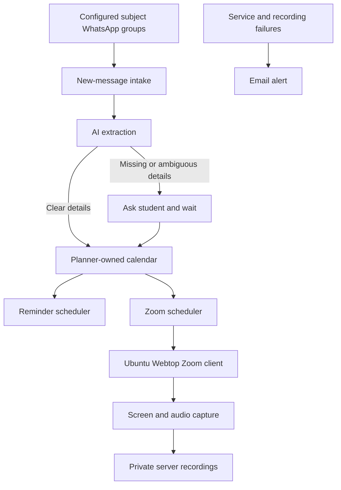

# Student Planner for WhatsApp Classes and Assignments

* **Author:** piragenth-satkunananthan
* **Status:** Proposed
* **Date:** 2026-11-07

--------------------------------------------------------------------------------

## Overview

The Student Planner is intended to help one student keep up with classes and assignments announced across separate subject WhatsApp groups. It turns lecturer posts into a shared calendar with reminders and aims to join and screen/audio-record Zoom classes on the user's server. The student should be able to check the planner from an Android phone or Arch Linux desktop. Unattended Zoom joining, admission, and detecting when the host ends a meeting still need to be proven in a test meeting before recording can be treated as dependable.

## The Problem

Lecturers post assignment instructions and Zoom links in subject WhatsApp groups. Important details can be missed among group messages, and manually entering every deadline and class into a calendar adds work and can still fail when a post is overlooked. The student needs one place to track those assignments and classes, receive reminders, and capture permitted lectures when they cannot join on time. When a post leaves an important date or class time unclear, the planner should ask the student rather than guess.

## Goals

* Create calendar entries from new, relevant lecturer posts in the student's configured subject groups, including assignment details and Zoom class links.
* Use AI to interpret assignment and class instructions, and ask the student when required information is missing or ambiguous.
* Treat a clear assignment date with no stated time as due at 11:59 PM Sri Lanka time. Remind the student at 9:00 AM Sri Lanka time on the day before and on the due date.
* Remind the student about Zoom classes at 9:00 AM Sri Lanka time the day before and one hour before the class. Ask for the class time when the post does not provide it.
* For a scheduled class, aim to join five minutes before it starts, wait up to 20 minutes for the meeting to open, capture screen and audio, and stop when the host ends the meeting. Report failures so the student can decide what to do next.
* Prove the message intake and unattended Zoom workflow with a test group and host-controlled test meeting before relying on it for live classes.

## Non-Goals

* Support multiple users or overlapping Zoom classes.
* Send messages or replies to subject WhatsApp groups.
* Guess unclear assignment dates or Zoom class times.
* Replace a full learning-management system.
* Support multiple WhatsApp automation libraries in the initial version.

## Open Questions

* **WhatsApp reliability**: Does the Baileys pilot receive new posts, reconnect, and recover after server downtime reliably enough for one live group? If it fails, does whatsapp-web.js pass the same pilot?
* **Local AI capacity**: Can the user's server run Ollama within its available memory and CPU while producing valid assignment and class details? The approved design queues posts rather than sending them to a hosted model if local inference is unavailable.
* **Unattended Zoom capture**: Can the Webtop account join and be admitted unattended, capture usable screen and audio, and expose a reliable host-ended state to the worker? This must pass a host-controlled meeting before live recording is enabled.
* **Late assignments**: How should the planner handle a lecturer post received after the stated deadline or a deadline that is already past?

## Critical User Journeys (CUJs)

### CUJ 1: Track an assignment from a lecturer post

* **Given**: The lecturer is configured as trusted in a subject group, and the assignment post gives a clear due date.
* **When**: The post arrives and the planner extracts its instructions.
* **Then**: The assignment appears in the planner-owned calendar with its source reference. If the post gives a date but no time, the due time is 11:59 PM Sri Lanka time. The planner sends the assignment reminders at 9:00 AM on the day before and on the due date.

### CUJ 2: Resolve an unclear post

* **Given**: A trusted lecturer post is missing a required deadline or Zoom class time, or the extracted details are ambiguous.
* **When**: The local extraction step marks the item for clarification.
* **Then**: The item stays pending, the student sees a question in the planner and receives an email notice, and the item is not scheduled with guessed details. After the student answers, the planner updates the calendar and applicable reminders.

### CUJ 3: Join and record a scheduled Zoom class

* **Given**: A confirmed class item exists, no other lecture is scheduled at the same time, and the tested Webtop worker is healthy.
* **When**: The scheduled join time arrives.
* **Then**: The worker opens the meeting five minutes early, waits up to 20 minutes for it to open, and captures screen and audio after admission. It stops when the host-ended state is detected, or at the four-hour recording cap if that signal is missed, and reports failures by email.

## Technical Plan (Architecture)

The service runs on the user's server and owns the planner calendar. A calendar view in the service makes the assignments and classes available from the user's Android phone and Arch Linux desktop. Each calendar item keeps a reference to the source WhatsApp message so the student can check where its details came from.

### Message intake and planning

* A WhatsApp intake client watches only new posts in configured subject groups from trusted lecturer senders. The one-group pilot tests Baileys first and tests whatsapp-web.js only if Baileys fails; the live service uses one client.
* Local Ollama extraction identifies assignment instructions, due dates, Zoom links, and class times from each relevant post. It does not import unrelated group history or send message text to a hosted model.
* Clear information becomes a planner item. If required details are missing or ambiguous, the item stays pending until the student answers or cancels it; the service does not create a scheduled class from a guessed time. Raw message text is retained only while clarification is pending, then the structured item and source reference remain.
* The planner calendar stores the source item and its reminder state. Assignment and class reminders use the Sri Lanka time rules in the Goals section and remain deduplicated when the service restarts or a post is received again.

### Zoom scheduling and capture

* The Zoom scheduler watches confirmed class items and starts the candidate Ubuntu Webtop desktop workflow five minutes before class.
* The Zoom client waits up to 20 minutes for the meeting to open. Once admitted, a screen and audio capture process saves the recording privately on the server.
* The capture must stop when the host ends the meeting. The Webtop worker will check the visible Zoom UI for the ended-meeting state and enforce a four-hour cap from recording start if that signal is missed. A host-controlled test must prove joining, admission, usable capture, end detection, and a valid saved recording. If any step fails, unattended recording stays disabled and the service reports the failure.

### Notifications and data flow

* The service sends scheduled reminders and shows clarification questions in the planner with an email notice. Email is the independent path for service and recording failures so a lost WhatsApp session cannot suppress every alert.
* Recordings stay on the user's server and can be deleted by the user. At 80% disk use, the service pauses new recordings and sends an email alert instead of deleting older recordings automatically.
* WhatsApp and Zoom session credentials stay out of routine logs. Intake health, pending questions, reminder results, Zoom join and recording outcomes, and available disk space are tracked without logging message text, meeting links, or passcodes.

## Alternatives Considered

### Manual forwarding to a private intake

* **Pros**: You control which messages reach the planner, and forwarding remains a fallback if automatic WhatsApp intake stops working or becomes unacceptable.
* **Cons**: It adds a repeated manual step and can still fail when you overlook a post.
* **Reason for rejection**: Rejected by author as the primary flow because routine forwarding conflicts with the goal of avoiding manual entry; retained as a possible fallback.

### Supporting Baileys and whatsapp-web.js together

* **Pros**: The service could compare both clients or switch if one stops receiving messages.
* **Cons**: It adds a second unofficial client, session, and recovery path to maintain without a stated need.
* **Reason for rejection**: Rejected by author for the initial scope because maintaining two unofficial clients adds work without a stated need; test one client first and use only the one that passes the pilot.

### Zoom's built-in recording controls

* **Pros**: This uses Zoom's own recording feature when the account and meeting settings allow it.
* **Cons**: Host and account controls determine whether recording is available, and recording controls do not solve unattended joining or admission.
* **Reason for rejection**: Rejected by author as the initial capture path because you selected local screen and audio capture in Ubuntu Webtop. Reconsider Zoom recording controls if the meeting settings allow them and they improve reliability.

### Zoom RTMS instead of a meeting-client capture path

* **Pros**: RTMS is Zoom's official media-stream route and avoids recording the full desktop.
* **Cons**: Host and administrator settings control access; an app used outside its Zoom account may require review. Starting a stream also requires an already-joined participant and an available host or alternate host.
* **Reason for not selecting now**: The required account, host, and administrator prerequisites have not been established, and RTMS does not provide the unattended join path by itself. Revisit it if those prerequisites are confirmed.

### An existing calendar account as the event source of truth

* **Pros**: Assignments and classes could appear in a calendar you already use on Android and Arch Linux.
* **Cons**: The planner would depend on that provider's access and synchronization behavior, and the provider would own event updates alongside WhatsApp source tracking.
* **Reason for rejection**: Rejected by author in favor of a planner-owned calendar as the source of truth.

## Non-Functional Requirements

* **Privacy and security**: Read only new posts from configured groups and trusted lecturer senders. Keep source text only while clarification is pending, run extraction locally, protect WhatsApp/Zoom credentials and backups, and keep message bodies, links, and passcodes out of routine logs and email subjects. Password-protect the planner and keep Webtop private; do not mount the container engine socket into the application.
* **Reliability**: Persist message, event, reminder, Zoom job, and recording states so restarts do not silently lose work. Use unique message and reminder keys, retry pending email deliveries, and send operational alerts through email independently of WhatsApp.
* **Storage and runtime limits**: Stop an individual recording after four hours if no host-ended signal arrives. At 80% disk use, pause new recordings and preserve existing files until the user deletes them. Verify local Ollama resource use before enabling automatic extraction.
* **Rollout**: Use a separate WhatsApp test group and host-controlled Zoom meeting first. Do not enable live-group intake or unattended recording until the corresponding pilot passes.

## Additional Resources

* [Node.js release schedule](https://nodejs.org/en/about/previous-releases)
* [Baileys installation and requirements](https://github.com/WhiskeySockets/docs/blob/main/installation.mdx)
* [whatsapp-web.js project](https://github.com/wwebjs/whatsapp-web.js/)
* [WhatsApp Terms of Service](https://www.whatsapp.com/legal/terms-of-service)
* [Zoom Linux Meeting SDK guidance](https://developers.zoom.us/docs/meeting-sdk/linux/)
* [Zoom bot controls](https://support.zoom.com/hc/en/article?id=zm_kb&sysparm_article=KB0088381)
* [LinuxServer Webtop documentation](https://docs.linuxserver.io/images/docker-webtop/)

## Detailed Implementation Plan

The repository has no application source or dependencies, so implementation starts as a small single-user web service. Use Node.js 24 LTS with TypeScript, Fastify for the web service, SQLite for planner data, and a plain responsive browser interface. Baileys is the first WhatsApp client to test because its stable Node package supports TypeScript and works without a browser; its project documentation requires Node.js 20 or later. If Baileys fails the one-group pilot, test whatsapp-web.js before selecting one client for live intake. The Node.js release table lists version 24 as LTS. [Node.js release schedule](https://nodejs.org/en/about/previous-releases), [Baileys installation](https://github.com/WhiskeySockets/docs/blob/main/installation.mdx), [Baileys project](https://github.com/WhiskeySockets/Baileys)

The planner owns its calendar in SQLite. AI extraction runs locally through Ollama; if the local model is unavailable, retain the message for review and alert the user rather than sending group content to a hosted model. Use email for operational failures and clarification notices, and an in-app queue for questions. The Zoom worker runs in a separate Ubuntu Webtop container and communicates with the planner over a private authenticated connection; it has no access to the container engine socket.

### Implementation stages

1. **Feasibility pilot**: Connect Baileys to the separate test group, then test reconnection, new posts, edits, duplicates, and restarts. Check that the local Ollama model runs within the server's resource limits and extracts representative synthetic posts correctly. Test the Webtop Zoom workflow in a host-controlled test meeting: login, unattended join, admission, screen/audio capture, the 20-minute opening wait, host-end detection, restart behavior, and saved-file verification. If Baileys fails, try whatsapp-web.js in the same test group. Do not connect a live subject group or enable unattended recording until its path passes.
2. **Planner core**: Build the SQLite store, local message extraction, clarification queue, planner-owned calendar, and persistent reminders. Use `Asia/Colombo`; date-only assignments are due at 11:59 PM, and reminder times follow the Goals section. Deduplicate delivery retries by source message identity; if an identical post arrives under a new identity, hold it for duplicate review. Edits update the existing item, cancellations stop its reminders, and user-edited fields are preserved. Keep raw message text only while clarification is pending.
3. **User access and alerts**: Serve a password-protected responsive calendar on the private network. Show pending questions, intake health, class status, and recording links; let the user answer clarifications and delete recordings. Send reminders and clarification notices by email as well as showing them in the planner; never send messages to class groups.
4. **Zoom worker**: After the feasibility pilot passes, let the scheduler submit one job at a time to the Webtop agent. It opens the confirmed meeting five minutes before start, waits up to 20 minutes, and starts FFmpeg screen/audio capture after admission. Detect the ended-meeting state from the visible Zoom UI and stop capture then; stop at a four-hour hard limit if that signal is missed, and send an alert. Save recordings under `/data/recordings`; pause new recordings at 80% disk use and alert rather than deleting files automatically.
5. **Private pilot and recovery**: Run one subject group and the test meeting through a server restart and an intake outage. Check reminder deduplication, message catch-up, recording recovery, email alerts, private Webtop access, and backup restore before enabling other groups.

### Target Files to Create or Modify

#### 1. `package.json` (Create)

* **Type / Scope**: Node.js application manifest.
* **Proposed Changes**: Pin Node 24 compatibility and add scripts for build, start, and verification. Add TypeScript, Fastify, static-file serving, SQLite, schema validation, email, and the single WhatsApp client selected by the pilot. Do not include both clients in the live application.

#### 2. `tsconfig.json` (Create)

* **Type / Scope**: TypeScript compiler configuration.
* **Proposed Changes**: Compile the planner and Webtop agent for Node.js 24 using strict type checks and a single `dist/` output tree.

#### 3. `package-lock.json` (Create)

* **Type / Scope**: npm dependency lockfile.
* **Proposed Changes**: Pin the exact dependency versions used by the planner build and deployment so a rebuild uses the same WhatsApp client and runtime libraries.

#### 4. `.gitignore` (Create)

* **Type / Scope**: Git exclusions.
* **Proposed Changes**: Exclude `.env`, WhatsApp session credentials, SQLite databases, generated output, downloaded AI models, and recordings so private runtime data cannot be committed accidentally.

#### 5. `.env.example` (Create)

* **Type / Scope**: Safe configuration example.
* **Proposed Changes**: Document the planner login, private bind address, subject group and lecturer IDs, timezone, local Ollama URL/model, SMTP settings, internal Webtop token, recording path, 80% storage threshold, and four-hour recording cap. Use placeholders only.

#### 6. `compose.yaml` (Create)

* **Type / Scope**: Server deployment.
* **Proposed Changes**: Define planner, local Ollama, and Ubuntu Webtop services with persistent data volumes. Keep Webtop off public ports, restrict service communication to the private container network, and do not mount the container engine socket into the planner.

#### 7. `src/config.ts` (Create)

* **Type / Scope**: Runtime configuration.
* **Proposed Changes**: Load and validate environment settings, default the timezone to `Asia/Colombo`, and fail startup when required secrets or storage paths are missing.

#### 8. `src/db.ts` (Create)

* **Type / Scope**: SQLite storage and migrations.
* **Proposed Changes**: Create tables for source messages, planner items, pending clarifications, reminder deliveries, Zoom jobs, and recording metadata. Enforce unique source-message IDs and unique reminder keys so replay and restart do not create duplicates.

#### 9. `src/whatsapp.ts` (Create)

* **Type / Scope**: WhatsApp linked-device intake.
* **Proposed Changes**: Connect the selected client, accept only new posts from configured subject groups and lecturer IDs, persist the last-seen message reference, expose connection health, and reconnect without logging message bodies or session credentials. Pilot Baileys first; use whatsapp-web.js only if the pilot fails.

#### 10. `src/ai.ts` (Create)

* **Type / Scope**: Local instruction extraction.
* **Proposed Changes**: Send only the selected lecturer post to local Ollama and require structured assignment/class fields. Validate the result at runtime; return missing or ambiguous fields for clarification rather than inventing values. No hosted model fallback is enabled.

#### 11. `src/planner.ts` (Create)

* **Type / Scope**: Assignment and class lifecycle.
* **Proposed Changes**: Create and update planner items with source references, statuses, user corrections, and cancellation handling. Deduplicate delivery retries by source message ID and hold identical reposts under new IDs for user review. Convert clear date-only deadlines to 11:59 PM Sri Lanka time; leave unclear items pending.

#### 12. `src/reminders.ts` (Create)

* **Type / Scope**: Persistent reminder scheduler.
* **Proposed Changes**: Create assignment reminders for 9:00 AM the day before and due date, and class reminders for 9:00 AM the day before and one hour before. Insert a unique pending delivery before sending, mark it delivered only after SMTP succeeds, and retry pending deliveries after restart; suppress reminders for canceled or unresolved items.

#### 13. `src/notifications.ts` (Create)

* **Type / Scope**: Email and in-app notices.
* **Proposed Changes**: Send reminders, clarification links, and failure alerts through configured SMTP. Keep message text, meeting links, and passcodes out of email subject lines and operational logs.

#### 14. `src/zoom.ts` (Create)

* **Type / Scope**: Zoom job scheduler and state tracking.
* **Proposed Changes**: Schedule confirmed non-overlapping classes, request a Webtop job five minutes before start, enforce the 20-minute wait, record job state, and alert when the agent fails or reaches the four-hour cap.

#### 15. `src/server.ts` (Create)

* **Type / Scope**: Fastify API and application startup.
* **Proposed Changes**: Serve the password-protected browser UI and planner API, accept Webtop agent status over the authenticated private network, and start intake, reminders, and Zoom scheduling from persisted database state.

#### 16. `web/index.html`, `web/app.js`, and `web/style.css` (Create)

* **Type / Scope**: Responsive planner interface.
* **Proposed Changes**: Provide calendar and upcoming-item views, a pending-clarification queue with answer forms, manual correction/cancellation, recording links and deletion, and health/failure status for Android and desktop browsers.

#### 17. `webtop/Dockerfile` (Create)

* **Type / Scope**: Ubuntu Webtop image.
* **Proposed Changes**: Extend the Ubuntu Webtop image with the Zoom desktop client, Node.js agent runtime, FFmpeg, `xdotool`, and Tesseract for reading the visible meeting-ended state. Keep the Webtop UI private.

#### 18. `webtop/agent.ts`, `webtop/zoom-ui.ts`, and `webtop/capture.ts` (Create)

* **Type / Scope**: Isolated desktop automation and recording worker.
* **Proposed Changes**: Poll the planner for one authorized job, open the meeting in the Zoom desktop, report admission state, capture X11 video and PulseAudio audio with FFmpeg, detect the tested end-of-meeting UI state, and stop at the four-hour cap. Report saved-file status to the planner; never accept a second concurrent job.

#### 19. `webtop/root/etc/services.d/zoom-agent/run` (Create)

* **Type / Scope**: Webtop process startup.
* **Proposed Changes**: Start the compiled Zoom agent under the Webtop container's service manager and restart it after a process failure without launching a duplicate capture job.

#### 20. `test/whatsapp.test.ts`, `test/extraction.test.ts`, `test/planner.test.ts`, `test/reminders.test.ts`, and `test/zoom.test.ts` (Create)

* **Type / Scope**: Automated unit tests.
* **Proposed Changes**: Cover group/sender filtering, invalid or ambiguous extraction, Sri Lanka date defaults, edit/cancel/duplicate handling, reminder idempotency, Zoom wait/end/cap state transitions, and restart recovery using fake messages and a fake Webtop agent.

#### 21. `test/fixtures/lecturer-posts.json` (Create)

* **Type / Scope**: Sanitized extraction examples.
* **Proposed Changes**: Store synthetic posts for clear and ambiguous assignment dates, class links with and without times, edits, cancellations, and duplicate messages. Do not put real class messages, links, or names in the repository.

#### 22. `README.md` (Modify)

* **Type / Scope**: User setup and operations guide.
* **Proposed Changes**: Document deployment, linking the WhatsApp account, configuring trusted groups and senders, setting SMTP and local AI, private Webtop access, storage behavior, backup/restore, test-group rollout, and recovery after session loss.

### Verification Plan

* **Build**: `npm run build` succeeds on Node.js 24 LTS.
* **Automated checks**: `npm test` passes the unit tests for extraction validation, timezone defaults, source deduplication, reminder idempotency, and Zoom worker state transitions.
* **WhatsApp and AI pilot**: In a separate test group, verify permitted senders, link and assignment extraction, edits, duplicates, disconnect/reconnect, and restart catch-up. Confirm the local model stays within server resource limits and unrelated groups and senders are ignored.
* **Zoom pilot**: In a host-controlled test meeting, prove unattended login/join/admission, the 20-minute wait and leave behavior, clear screen/audio, host-ended detection, four-hour cutoff signaling, saved-file verification, and restart behavior. Keep the Webtop UI private.
* **Data handling**: Verify raw text is removed after clarification, credentials and links do not appear in routine logs, recordings remain private and user-deletable, disk threshold pauses new recordings, and backup restore preserves planner state.
* **Release gate**: Enable one live subject group only after the WhatsApp and Zoom pilots pass. If host-end detection or audio capture fails, keep unattended recording disabled and report the limitation.

--------------------------------------------------------------------------------

*Drafted with EGM*
