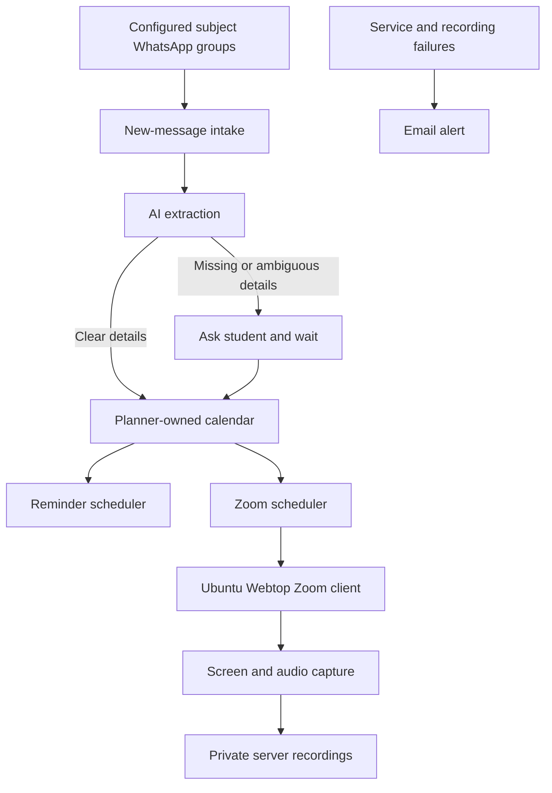

# Student Planner for WhatsApp Classes and Assignments

* **Author:** piragenth-satkunananthan
* **Status:** Approved
* **Date:** 2026-11-08

--------------------------------------------------------------------------------

> **Decision update 2026-11-09:** The user approved allowing the non-ZDR Google AI Studio endpoint for `google/gemma-4-31b-it:free`. This is the only `provider.zdr: false` exception; every other model remains ZDR-only. `provider.data_collection: "deny"`, `provider.require_parameters: true`, and `provider.allow_fallbacks: false` remain required. The Google privacy group must allow the least-permissive non-ZDR option that permits this endpoint; the All other models group remains ZDR-only. The 2026-11-09 rerun reached the endpoint but returned HTTP 429; a second paced retry returned 429 as well, so the comparison is incomplete and no model is selected.
>
> **Decision update 2026-11-09 (bounded fallback chain):** The user authorized a fallback chain of at most two free models. Each member must pass the full synthetic gate and have an approved privacy profile. Fallback is allowed only for availability failures (HTTP 429, timeout, network, upstream or invalid response); local validation failures do not trigger fallback. The serving model must be recorded. If no member passes, extraction stays disabled. As of 2026-11-09 no second free model passed the gate, so the chain is authorized but not enabled.
>
> **Decision update 2026-11-09 (NVIDIA activation):** The user approved NVIDIA Build as an active provider and accepted its data terms. `nvidia/nemotron-3-ultra-550b-a55b` is pinned. Configuration, extraction pipeline, and configured factory are implemented. `EXTRACTION_ENABLED` remains false by default, so no live extraction starts; live intake remains disabled.
>
> **Decision update 2026-11-09 (any-member posts):** The user reported that students also post class links and times in the target group, and that requiring a lecturer test message was not workable. The planner supports an opt-in `allowAllSenders` setting per tracked group: when enabled, any member's message can be processed. The default remains lecturer-only. Sender provenance is retained, extraction validation still applies, and this weakens the trusted-sender gate; student posts can create items.
>
> **Decision update 2026-11-09 (gate semantics):** The model gate compares structured fields exactly and validates evidence through the extractor. Free-text fields accept source-supported normalized spans; the model is not required to reproduce a curated fixture quote. Exact checks remain for dates, times, enums, nulls, item counts, `ambiguous_fields`, and `zoom_url`.
>
> **Decision update 2026-11-09 (sequencing):** The user authorized starting Planner core Phase 2A–2C before the model gate passes. The SQLite schema, item lifecycle, clarification resolution, and reminder scheduling are implemented; extraction and live intake remain disabled.

## Overview

The Student Planner tracks classes and assignments announced in the student's subject WhatsApp groups. It adds lecturer posts to its planner-owned calendar, sends reminders, and is designed to join Zoom classes and record the screen and audio on the user's server. The calendar is available from Android and Arch Linux browsers. Unattended joining, admission, and host-end detection must pass a test meeting before live recording is enabled.

## The Problem

Lecturers post assignment instructions and Zoom links in subject WhatsApp groups. Important details can be missed among group messages, and manually entering every deadline and class into a calendar adds work and can still fail when a post is overlooked. The student needs one place to track those assignments and classes, receive reminders, and capture permitted lectures when they cannot join on time. When a post leaves an important date or class time unclear, the planner should ask the student rather than guess.

## Goals

* Create calendar entries from new, relevant lecturer posts in the student's configured subject groups, including assignment details and Zoom class links.
* Use AI to interpret assignment and class instructions, and ask the student when required information is missing or ambiguous.
* Treat a clear assignment date with no stated time as due at 11:59 PM Sri Lanka time. Remind the student at 9:00 AM Sri Lanka time on the day before and on the due date.
* Remind the student about Zoom classes at 9:00 AM Sri Lanka time the day before and one hour before the class. Ask for the class time when the post does not provide it.
* For a scheduled class, aim to join five minutes before it starts, wait up to 20 minutes for the meeting to open, capture screen and audio, and stop when the host ends the meeting. Report failures so the student can decide what to do next.
* Prove the message intake and unattended Zoom workflow with a test group and host-controlled test meeting before relying on it for live classes.

## Non-Goals

* Support multiple users or overlapping Zoom classes.
* Send messages or replies to subject WhatsApp groups.
* Guess unclear assignment dates or Zoom class times.
* Replace a full learning-management system.
* Support multiple WhatsApp automation libraries in the initial version.

## Open Questions

* **WhatsApp reliability**: Does the Baileys pilot receive new posts, reconnect, and recover after server downtime reliably enough for one live group? If it fails, does whatsapp-web.js pass the same pilot?
* **OpenRouter model quality and availability**: Does a free OpenRouter model pass every synthetic fixture, including field-level evidence checks, and does its selected provider route support JSON mode reliably?
* **Unattended Zoom capture**: Can the Webtop account join and be admitted unattended, capture usable screen and audio, and expose a reliable host-ended state to the worker? This must pass a host-controlled meeting before live recording is enabled.
* **Late assignments**: If an assignment arrives after its due time, create it as `overdue_review`, send no scheduled deadline reminders, and ask the student whether to keep it for reference or archive it.

## Critical User Journeys (CUJs)

### CUJ 1: Track an assignment from a lecturer post

* **Given**: The lecturer is configured as trusted in a subject group, and the assignment post gives a clear due date.
* **When**: The post arrives and the planner extracts its instructions.
* **Then**: The assignment appears in the planner-owned calendar with its source reference. If the post gives a date but no time, the due time is 11:59 PM Sri Lanka time. The planner sends the assignment reminders at 9:00 AM on the day before and on the due date.

### CUJ 2: Resolve an unclear post

* **Given**: A trusted lecturer post is missing a required deadline or Zoom class time, or the extracted details are ambiguous.
* **When**: OpenRouter extraction marks the item for clarification.
* **Then**: The item stays pending, the student sees a question in the planner and receives an email notice, and the item is not scheduled with guessed details. After the student answers, the planner updates the calendar and applicable reminders.

### CUJ 3: Join and record a scheduled Zoom class

* **Given**: A confirmed class item exists, no other lecture is scheduled at the same time, and the Webtop worker's startup preflight reports a signed-in configured Zoom account and available screen/audio capture devices.
* **When**: The scheduled join time arrives.
* **Then**: The worker opens the meeting five minutes early, waits up to 20 minutes for it to open, and captures screen and audio after admission. It stops when the host-ended state is detected, or at the four-hour recording cap if that signal is missed, and reports failures by email.

## Technical Plan (Architecture)

The service runs on the user's server and owns the planner calendar. A calendar view in the service makes the assignments and classes available from the user's Android phone and Arch Linux desktop. Both devices use a browser to reach the planner over authenticated HTTPS on the private LAN; remote access requires the user's VPN into that network. Each calendar item keeps a reference to the source WhatsApp message so the student can check where its details came from.

### Message intake and planning

* A WhatsApp intake client watches only new posts in configured subject groups from trusted lecturer senders. The one-group pilot tests Baileys first and tests whatsapp-web.js only if Baileys fails; the live service uses one client. Before enabling live-group intake, the owner checks the current WhatsApp terms and the selected client's current policy, records the check date and account-risk decision, and uses manual forwarding if automated access is not acceptable. If the account is restricted, stop automated intake and alert the user.
* OpenRouter Chat Completions and NVIDIA Build are the approved model providers. The OpenRouter path uses one selected lecturer post per request and `response_format: { type: "json_object" }` with `provider.require_parameters: true`. Every request also sets `provider.data_collection: "deny"` and `provider.allow_fallbacks: false`. `provider.zdr: true` is required except for the approved `google/gemma-4-31b-it:free` path, which uses its non-ZDR Google AI Studio endpoint with `provider.zdr: false`. Send the post text, timestamp, `Asia/Colombo`, URL placeholders, and link indexes with Zoom flags. Do not send WhatsApp message IDs, group IDs, sender IDs, actual URLs, or passcodes. The user accepts OpenRouter's selected upstream provider route and its data practices. Choose a free model only after it passes the synthetic comparison; Gemma 4 31B is a candidate, not a fixed choice. Compare free OpenRouter candidates only. Do not add paid or local model fallback. Require all expected fields with explicit nulls when unavailable, then enforce the strict local schema, exact field evidence, semantic/date checks, and existing Zoom-link index validation.
* NVIDIA Build is the second approved provider. It uses its OpenAI-compatible Chat Completions endpoint with the pinned `nvidia/nemotron-3-ultra-550b-a55b`, JSON mode, `chat_template_kwargs.enable_thinking: false`, and a 60-second timeout. The user approved this provider and its data terms on 2026-11-09. OpenRouter's provider controls do not apply to NVIDIA. Extraction remains disabled by default until `EXTRACTION_ENABLED=true` and the integration checks pass.
* Use the existing event fields `kind`, `title`, `details`, `due_date`, `due_time`, `class_date`, and `class_time`. Add nullable `course`, `location`, `change_type` (`cancelled`, `rescheduled`, or null), and `change_details`. Put unclear fields in `ambiguous_fields`. For every non-null factual field, map its name in `field_evidence` to one or more exact `{ quote }` entries from the single post. Each quote must occur in both the model-visible text and original local post and must support the field and normalized value. The app checks dates and times against the quoted wording and source timestamp in `Asia/Colombo`. The app attaches the original source reference after validation; the model never supplies source identifiers. `zoom_url` is derived locally from the validated link index and needs no model evidence.
* Clear, supported information becomes a planner item. Missing or ambiguous required details stay pending for clarification; do not guess or partially accept an event as confirmed. Keep raw message text only while clarification is pending. Store validated evidence quotes with the event, delete them from the live database when the event is deleted, and do not log them separately. Encrypted backups may retain deleted quotes until the existing seven-daily and four-weekly rotation expires. After raw text is deleted, retain the group, message ID, sender, timestamp, and original-message link if available as provenance; do not reproduce the deleted message body.
* Use a 60-second request timeout and no automatic retries. Treat provider errors, rate limits, empty or malformed responses, schema failures, and invalid evidence as extraction failures. Retain failed posts locally for retry or manual review once the durable planner path exists. Keep live intake disabled until that failure path is implemented; alert the user when extraction fails.
* The planner calendar stores the source item and its reminder state. Assignment and class reminders use the Sri Lanka time rules in the Goals section and remain deduplicated when the service restarts or a post is received again.

### Zoom scheduling and capture

* The Zoom scheduler watches confirmed class items for which permission is confirmed and starts the candidate Ubuntu Webtop desktop workflow five minutes before class.
* The Zoom client waits up to 20 minutes for the meeting to open. Once admitted, a screen and audio capture process saves the recording privately on the server.
* Start capture only when the worker can verify admission through the configured account and host settings and permission for that class is confirmed. Do not bypass blocked controls. If permission or admission cannot be confirmed, do not capture; report the failure and keep unattended recording disabled for that class.
* The capture must stop when the host ends the meeting. The Webtop worker checks the visible Zoom UI for the ended-meeting state and enforces a four-hour cap from recording start if that signal is missed. During capture, check free space at least every 15 seconds and stop and finalize the recording if free space falls below 10 GiB. Send an alert and test this stop condition in the Zoom pilot. If any required step fails, unattended recording stays disabled and the service reports the failure.

### Notifications and data flow

* The service sends scheduled reminders and shows clarification questions in the planner with an email notice. Email is the independent path for service and recording failures so email notices remain available when WhatsApp intake is disconnected, provided SMTP is working.
* Recordings stay on the user's server and can be deleted by the user. At 80% disk use, the service pauses new recordings; during an active capture it also stops and finalizes the file if free space falls below 10 GiB. It sends an email alert instead of deleting older recordings automatically.
* WhatsApp and Zoom session credentials stay out of routine logs. Intake health, pending questions, reminder results, Zoom join and recording outcomes, and available disk space are tracked without logging message text, meeting links, or passcodes.

## Alternatives Considered

### Manual forwarding to a private intake

* **Pros**: You control which messages reach the planner, and forwarding remains a fallback if automatic WhatsApp intake stops working or becomes unacceptable.
* **Cons**: It adds a repeated manual step and can still fail when you overlook a post.
* **Reason for rejection**: Rejected by author as the primary flow because routine forwarding conflicts with the goal of avoiding manual entry; retained as a possible fallback.

### Supporting Baileys and whatsapp-web.js together

* **Pros**: The service could compare both clients or switch if one stops receiving messages.
* **Cons**: It adds a second unofficial client, session, and recovery path to maintain without a stated need.
* **Reason for rejection**: Rejected by author for the initial scope because maintaining two unofficial clients adds work without a stated need; test one client first and use only the one that passes the pilot.

### Zoom's built-in recording controls

* **Pros**: This uses Zoom's own recording feature when the account and meeting settings allow it.
* **Cons**: Host and account controls determine whether recording is available, and recording controls do not solve unattended joining or admission.
* **Reason for rejection**: Rejected by author as the initial capture path because you selected local screen and audio capture in Ubuntu Webtop. Reconsider Zoom recording controls if the meeting settings allow them and they improve reliability.

### Zoom RTMS instead of a meeting-client capture path

* **Pros**: RTMS is Zoom's official media-stream route and avoids recording the full desktop.
* **Cons**: Host and administrator settings control access; an app used outside its Zoom account may require review. Starting a stream also requires an already-joined participant and an available host or alternate host.
* **Reason for not selecting now**: The required account, host, and administrator prerequisites have not been established, and RTMS does not provide the unattended join path by itself. Revisit it if those prerequisites are confirmed.

### An existing calendar account as the event source of truth

* **Pros**: Assignments and classes could appear in a calendar you already use on Android and Arch Linux.
* **Cons**: The planner would depend on that provider's access and synchronization behavior, and the provider would own event updates alongside WhatsApp source tracking.
* **Reason for rejection**: Rejected by author in favor of a planner-owned calendar as the source of truth.

## Non-Functional Requirements

* **Privacy and security**: Read only new posts from configured groups and trusted lecturer senders. Send only selected post text, timestamp, timezone, URL placeholders, and link indexes to the active model provider (OpenRouter or NVIDIA Build). Do not send WhatsApp IDs, actual URLs, or passcodes. OpenRouter may select an upstream provider; its route and data practices apply. For `google/gemma-4-31b-it:free`, the approved route is Google AI Studio with `provider.zdr: false`; data collection remains denied. The user accepted this route on 2026-11-09. When NVIDIA Build is enabled, NVIDIA's data-retention and API terms apply; OpenRouter's ZDR/data-collection controls do not. The user approved NVIDIA as an active provider on 2026-11-09. Keep message bodies and evidence quotes out of routine logs and email subjects. Store quotes only with validated events, remove them from the live database when the event is deleted, and state that encrypted backups may retain them through the existing seven-daily and four-weekly rotation. Protect WhatsApp/Zoom credentials and backups. Require authenticated HTTPS for planner access. Expose the Webtop interface only on the same private network used by the user's devices, require its own interactive authentication separate from the planner-to-agent token, and restrict terminal and passwordless-sudo access to the user. Do not expose Webtop publicly or mount the container engine socket into the application.
* **Reliability**: Persist message, event, reminder, Zoom job, and recording states so restarts do not silently lose work. Use unique message and reminder keys. Email delivery is at-least-once: a duplicate notice is possible if SMTP accepts a message and the service stops before recording delivery. Persist each attempt and expose delivery status in the planner; do not promise exactly-once SMTP delivery. Send operational alerts through email independently of WhatsApp.
* **Storage and runtime limits**: Stop an individual recording after four hours if no host-ended signal arrives. At 80% disk use, pause new recordings; during active capture, check at least every 15 seconds and stop and finalize the file below 10 GiB free. Preserve existing recordings until the user deletes them. OpenRouter free-route availability and limits can pause extraction; use a 60-second timeout, no automatic retries, and retain failed posts locally for retry or manual review once the durable planner path exists.
* **Rollout**: Use a separate WhatsApp test group and host-controlled Zoom meeting first. Before live-group intake, record the current WhatsApp policy check and account-risk decision. Do not enable live-group intake or unattended recording until the corresponding pilot and authorization checks pass.

## Additional Resources

* [Node.js release schedule](https://nodejs.org/en/about/previous-releases)
* [Baileys installation and requirements](https://github.com/WhiskeySockets/docs/blob/main/installation.mdx)
* [whatsapp-web.js project](https://github.com/wwebjs/whatsapp-web.js/)
* [WhatsApp Terms of Service](https://www.whatsapp.com/legal/terms-of-service)
* [Zoom Linux Meeting SDK guidance](https://developers.zoom.us/docs/meeting-sdk/linux/)
* [Zoom bot controls](https://support.zoom.com/hc/en/article?id=zm_kb&sysparm_article=KB0088381)
* [LinuxServer Webtop documentation](https://docs.linuxserver.io/images/docker-webtop/)
* [OpenRouter Chat Completions](https://openrouter.ai/docs/api/api-reference/chat/create-a-chat-completion)
* [OpenRouter structured outputs](https://openrouter.ai/docs/guides/features/structured-outputs)
* [OpenRouter provider routing](https://openrouter.ai/docs/guides/routing/provider-selection)
* [OpenRouter privacy policy](https://openrouter.ai/privacy)
* [Gemma 4 31B free model candidate](https://openrouter.ai/google/gemma-4-31b-it:free)

## Detailed Implementation Plan

The repository has a Node.js 24 TypeScript foundation and an OpenRouter extraction adapter, but no planner server or browser interface yet. Build the single-user planner service with Fastify 5, `@fastify/static` 10, `@fastify/secure-session` 8, `better-sqlite3` 13, and Nodemailer 10; use the matching `@types/better-sqlite3` types. Lock exact resolved versions in `package-lock.json`. Use SQLite's `better-sqlite3` online backup API and Node's built-in `crypto` for backup encryption. The current WhatsApp dependency is pinned to `@whiskeysockets/baileys` `7.0.0-rc14`, a prerelease; pilot and deployment must use that same exact version. If Baileys fails the one-group pilot, test and pin one `whatsapp-web.js` version before deployment. [Node.js release schedule](https://nodejs.org/en/about/previous-releases), [Fastify 5 Node.js requirement](https://fastify.dev/docs/latest/Guides/Migration-Guide-V5/), [static plugin compatibility](https://github.com/fastify/fastify-static), [secure session plugin](https://github.com/fastify/fastify-secure-session), [better-sqlite3 API](https://github.com/WiseLibs/better-sqlite3/blob/master/docs/api.md), [Nodemailer requirements](https://nodemailer.com/), [Baileys installation](https://github.com/WhiskeySockets/docs/blob/main/installation.mdx), [Baileys project](https://github.com/WhiskeySockets/Baileys)

The planner owns its calendar in SQLite. Once a free model passes the synthetic comparison, pin its exact ID in `OPENROUTER_MODEL`; until then, leave the setting unset and keep extraction and live intake disabled. Extraction also remains disabled if the API key or required privacy route controls are unavailable. Send one selected lecturer post at a time to OpenRouter for JSON extraction and validate the complete response and evidence locally before attaching source provenance. Every request sets `provider.require_parameters: true`, `provider.data_collection: "deny"`, and `provider.allow_fallbacks: false`. Use `provider.zdr: true` for every model except `google/gemma-4-31b-it:free`, whose non-ZDR Google AI Studio endpoint the user approved on 2026-11-09; that path uses `provider.zdr: false`. Before enabling extraction, set the Google group's account privacy to the least-permissive non-ZDR option that permits Google AI Studio, keep the All other models group ZDR-only, verify both settings, and record the setting labels and check date. If the settings or a qualifying route are unavailable, fail closed, retain the post under the failed-message policy below, and alert the user. This applies the current [OpenRouter provider controls](https://openrouter.ai/docs/guides/routing/provider-selection), [ZDR control](https://openrouter.ai/docs/guides/features/zdr), and [data-collection control](https://openrouter.ai/docs/guides/privacy/data-collection). Use email for operational failures and clarification notices, and an in-app queue for questions. The Zoom worker runs in a separate Ubuntu Webtop container and communicates with the planner over a private authenticated connection; it has no access to the container engine socket. The Android phone and Arch Linux desktop reach the planner through authenticated HTTPS on the private LAN; access from outside that LAN requires the user's VPN.

### Implementation stages

1. **Feasibility pilot**: Run each shortlisted free OpenRouter model on the same synthetic fixtures. Compare every normalized field and evidence quote; require 100% expected-field accuracy, valid evidence for every non-null fact, and zero unsupported or ambiguous items confirmed. Verify JSON mode and all required provider controls on every request. Do not send WhatsApp IDs, group IDs, sender IDs, actual URLs, passcodes, or real WhatsApp posts to model candidates. Use one 60-second attempt with no automatic retry. If no free candidate passes, keep extraction disabled. Connect the exact pinned Baileys version to the separate test group only; test at least 10 eligible messages and 10 messages from untrusted groups or senders, and perform at least two disconnect/restart recovery cycles. Require 100% recovery of eligible messages, exactly one intake per source message, and zero acceptance of untrusted messages across that run. Do not send its real posts to any model. Test the Webtop Zoom workflow in a host-controlled meeting: verify permission, the configured account email, admission, screen and audio capture, the 20-minute opening wait, host-end detection within 30 seconds, the low-space stop, restart behavior, and saved-file verification. A reviewer must confirm both screen and audio are usable in a saved sample. If Baileys fails, try whatsapp-web.js in the same test group and apply the same acceptance criteria. Do not connect a live subject group or enable unattended recording until its corresponding pilot and authorization checks pass.
2. **Planner core**: Build the SQLite store, local message extraction, clarification queue, planner-owned calendar, and persistent reminders. Use `Asia/Colombo`; date-only assignments are due at 11:59 PM, and reminder times follow the Goals section. Store source messages by `(group_id, message_id)` with sender ID and sent timestamp; planner items reference their source message. Source messages also store extraction state (`received`, `extracting`, `pending_review`, `failed`, `confirmed`, `expired`, or `deleted`), safe failure code, attempt count, last-attempt time, and raw-text expiry. A user retry changes `failed` to `extracting` for one attempt; a new failure returns it to `failed`, clarification changes it to `pending_review`, and successful confirmation changes it to `confirmed`. At 30 days or user deletion, remove raw text and set `expired` or `deleted`; retain only provenance and safe failure state. Clarifications reference one planner item and source message, and record question, requested fields, creation time, resolution time, answer, and state. Reminder deliveries reference one planner item and have a unique `(item_id, reminder_kind, scheduled_at)` key, state, attempts, and last error. Zoom jobs reference one class item and have a unique job ID, random `lease_id`, lease owner/expiry, state, and timestamps; recording metadata references one job and stores a unique recording ID, relative path, start/end times, file status, and deletion time. Enforce foreign keys and unique source-message IDs. Items have `pending`, `confirmed`, `cancelled`, `overdue_review`, or `archived` status and retain their source identity. A quoted or replied-to message identifies the item changed or cancelled; without that reference, apply a correction or cancellation only when exactly one open item in that group matches the stated subject and date, otherwise ask the student. A user's corrected field takes precedence over later message edits until the user clears that correction. Repeated delivery of the same message ID is idempotent; identical content under a new ID remains in duplicate review. Keep raw text for clarification only while unresolved. Overdue archive keeps the item and provenance, hides it from the default calendar, suppresses reminders and recording, and does not delete it; the user can still view it in archived items.
3. **User access and alerts**: Serve a password-protected responsive calendar over authenticated HTTPS on the private network. Use `PLANNER_PASSWORD` for the single operator login and `SESSION_KEY_FILE` for the 32-byte `@fastify/secure-session` key. `POST /api/session` accepts `{ password }`, sets a six-hour `HttpOnly`, `Secure`, `SameSite=Strict` cookie; `DELETE /api/session` logs out. Require a valid session for browser/API routes, check the request `Origin` on state-changing browser routes, and keep the Webtop bearer token separate. Android and Arch Linux browsers access it on the private LAN; remote access requires the user's VPN. Show pending questions, intake health, class status, source provenance with field evidence quotes, and recording links; let the user answer clarifications and delete recordings. Send reminders and clarification notices by email as well as showing them in the planner; never send messages to class groups.
4. **Zoom worker**: After the feasibility pilot passes, let the scheduler submit one job at a time to the Webtop agent only for a class whose per-class `recording_permission` is `confirmed`, recorded with confirmer and time. The user explicitly confirms permission in the planner; unknown or declined permission prevents job creation. Set `ZOOM_ACCOUNT_EMAIL` to the permitted signed-in account. The worker verifies that the Zoom profile email matches it and that the meeting UI has left waiting-room/host-not-started states and shows the in-meeting controls. A mismatch, unknown UI state, waiting room, or denied admission fails closed and capture does not start. It opens the confirmed meeting five minutes before start, waits up to 20 minutes, and starts FFmpeg screen and audio capture after admission. Detect the ended-meeting state from the visible Zoom UI and stop capture then; stop at a four-hour hard limit if that signal is missed. Check free space at least every 15 seconds and stop and finalize capture below 10 GiB free. Save recordings under `/data/recordings`, alert on stop or failure, and do not delete older recordings automatically. At agent startup, report ready only when the configured profile email matches and the X11 display and PulseAudio source are available; otherwise report unhealthy and do not accept jobs.
5. **Private pilot and recovery**: Run one subject group and the test meeting through a server restart and an intake outage. Check reminder deduplication, message catch-up, recording recovery, email alerts, private Webtop access, and backup restore before enabling other groups. Create a daily SQLite online backup with `better-sqlite3`'s `Database.backup()` API, including planner state and recording metadata, to a separately mounted destination configured by `BACKUP_PATH`. Encrypt each snapshot with Node `crypto` AES-256-GCM using a fresh 12-byte nonce and a 32-byte raw key from `BACKUP_ENCRYPTION_KEY_FILE`; store a versioned header, key ID, nonce, ciphertext, and 16-byte authentication tag. The temporary plaintext SQLite snapshot must be mode 0600 and removed after encryption, including on failure. Keep current and retired key files outside both database and backup destinations; restore selects the key by key ID and verifies the authentication tag before opening the snapshot. Deployment remains blocked until separate storage, key rotation, and restore using the active key are verified. Retain seven daily and four weekly copies. Exclude credentials and recording video files. Restore by stopping the service, restoring a selected snapshot, and verifying planner items, reminders, and metadata before restart. Document that video files are not recoverable from this backup and that expired snapshots may contain data deleted from the live database until retention expires.

### Target Files to Create or Modify

#### 1. `package.json` (Modify)

* **Type / Scope**: Node.js application manifest.
* **Proposed Changes**: Preserve Node 24 compatibility and current build, test, and pilot scripts; add `fastify` 5, matching `@fastify/static` 10, `@fastify/secure-session` 8, `better-sqlite3` 13, and `nodemailer` 10; add `@types/better-sqlite3` for TypeScript. These versions support the Node 24 target; pin exact resolved versions in `package-lock.json`. Reuse installed TypeScript and Zod. Keep `@whiskeysockets/baileys` pinned to the tested exact version `7.0.0-rc14`, or replace it with one exact tested `whatsapp-web.js` version if Baileys fails. Do not include both clients in the live application. The pilot scripts and `test/whatsapp.test.ts` are existing callers of `selectLecturerPosts`; preserve that export and behavior.

#### 2. `tsconfig.json` (Modify)

* **Type / Scope**: TypeScript compiler configuration.
* **Proposed Changes**: Compile the planner and Webtop agent for Node.js 24 using strict type checks and a single `dist/` output tree.

#### 3. `package-lock.json` (Modify)

* **Type / Scope**: npm dependency lockfile.
* **Proposed Changes**: Pin the exact dependency versions used by the planner build and deployment so a rebuild uses the same WhatsApp client and runtime libraries.

#### 4. `.gitignore` (Modify)

* **Type / Scope**: Git exclusions.
* **Proposed Changes**: Exclude `.env`, WhatsApp session credentials, SQLite databases, generated output, downloaded AI models, and recordings so private runtime data cannot be committed accidentally.

#### 5. `.env.example` (Modify)

* **Type / Scope**: Safe configuration example.
* **Proposed Changes**: Preserve current settings and add unset `OPENROUTER_MODEL`, `PLANNER_PASSWORD`, `SESSION_KEY_FILE`, and `ZOOM_ACCOUNT_EMAIL`; extraction and intake stay disabled until the model and key pass their gates. Document subject group and lecturer IDs, SMTP, Webtop token, recording path, and recording limits. Add `BACKUP_PATH` and `BACKUP_ENCRYPTION_KEY_FILE` as deployment-supplied values. Use placeholders only; do not place secrets or key material in the database, backup destination, or example file.

#### 6. `compose.yaml` (Create; deployment gate)

* **Type / Scope**: Server deployment.
* **Proposed Changes**: Define planner and Ubuntu Webtop services with persistent data volumes. Before deployment, select and record a pinned LinuxServer Webtop image tag and Xfce/X11 session, and document the tested capture display/audio device settings. Keep Webtop off public ports, restrict service communication to the private container network, and do not mount the container engine socket into the planner. Deployment is blocked until the operator provides the actual HTTPS termination point, certificate provisioning/renewal procedure, and private LAN hostname; do not assume a domain or machine path.

#### 7. `src/config.ts` (Modify)

* **Type / Scope**: Runtime configuration.
* **Proposed Changes**: Preserve and extend `AppConfig` and `loadConfig`; keep `Asia/Colombo` default and existing path, token, SMTP, and numeric validation. Make OpenRouter API key optional for startup and add optional `OPENROUTER_MODEL`; until both are present and the model exactly matches the recorded passing `:free` candidate, expose extraction as disabled and do not start live intake. Require `PLANNER_PASSWORD` and a valid `SESSION_KEY_FILE` before serving user routes; validate backup destination/key and `ZOOM_ACCOUNT_EMAIL` before enabling their features.

#### 8. `src/db.ts` (Create)

* **Type / Scope**: SQLite storage and migrations.
* **Proposed Changes**: Use `better-sqlite3`. Create tables for source messages, planner items, pending clarifications, reminder deliveries, Zoom jobs, and recording metadata. Source messages have primary key `(group_id, message_id)` plus sender ID, sent timestamp, raw text/expiry, extraction state, safe failure code, attempt count, and last-attempt time. States are `received -> extracting -> pending_review | failed | confirmed`; user retry changes `failed -> extracting`; expiry/user deletion removes raw text and changes state to `expired`/`deleted`, retaining provenance and safe failure code. Planner items have a primary key, source-message foreign key, kind, state, due/class time, correction fields, evidence, and nullable per-class recording permission with confirmer/time; use `pending`, `confirmed`, `cancelled`, `overdue_review`, and `archived`. Clarifications have primary key, planner-item/source-message foreign keys, question, requested fields, state, answer, and created/resolved timestamps. Reminder deliveries reference one planner item and have unique `(item_id, kind, scheduled_at)`, state, attempts, and last error. Zoom jobs have primary key, unique item foreign key, random `lease_id`, lease owner/expiry, state, and timestamps. Recording metadata has primary key, unique job foreign key, relative path, start/end, file status, and deletion time. Enforce foreign keys and uniqueness so replay and restart do not duplicate records. Keep evidence quotes with their planner item and delete them with it; encrypted backups may retain them until retention expires.

#### 9. `src/whatsapp.ts` (Modify)

* **Type / Scope**: WhatsApp linked-device intake.
* **Proposed Changes**: Preserve exported `selectLecturerPosts` and its callers in `scripts/whatsapp-pilot.ts` and `test/whatsapp.test.ts`. Extend it for durable intake without breaking the pilot contract. Connect only the client/version that passed the pilot; accept only configured groups and lecturer IDs, persist the last-seen message reference, expose connection health, and reconnect without logging message bodies or credentials. Before live intake, record the current policy check date and account-risk decision; stop and alert if restricted. Pilot the currently pinned Baileys `7.0.0-rc14` first; use one exact tested whatsapp-web.js version only if it fails.

#### 10. `src/ai.ts` (Modify)

* **Type / Scope**: OpenRouter instruction extraction.
* **Proposed Changes**: Preserve `createOpenRouterAnnouncementExtractor`, `OpenRouterConfig`, and current validation behavior used by `scripts/model-comparison-pilot.ts`, `test/ai.test.ts`, and `test/openrouter.test.ts`. Add the passing model runtime setting and require JSON mode plus `provider.require_parameters: true`, `data_collection: "deny"`, and `allow_fallbacks: false`; use `zdr: true` for every model except the approved `google/gemma-4-31b-it:free` path, which uses `zdr: false`. The operator must set the Google group to the least-permissive non-ZDR option that permits Google AI Studio, keep All other models ZDR-only, and verify both settings before enabling extraction. Send no WhatsApp identifiers, actual URLs, or passcodes. If model config is absent or the provider cannot meet these constraints, do not call extraction; preserve the source for failed-message review. Compare free candidates only; no paid/local fallback. Preserve valid incomplete announcements for clarification; reject invalid output.

#### 11. `src/planner.ts` (Create)

* **Type / Scope**: Assignment and class lifecycle.
* **Proposed Changes**: Create and update planner items with source identity, states, per-class permission confirmation, corrections, and cancellation handling. Match edits through a quoted/replied-to message, or a unique open item matching group, subject, and date; otherwise ask the user. Preserve user-corrected fields until cleared. Deduplicate by `(group_id, message_id)` and hold identical reposts under new IDs for user review. Convert clear date-only deadlines to 11:59 PM Sri Lanka time; keep unclear items pending and overdue items in `overdue_review` without scheduled reminders. Archiving an overdue item sets `archived`, hides it from default views, suppresses reminders and recording, and retains the item/provenance until user deletion.

#### 12. `src/reminders.ts` (Create)

* **Type / Scope**: Persistent reminder scheduler.
* **Proposed Changes**: Create assignment reminders for 9:00 AM the day before and due date, and class reminders for 9:00 AM the day before and one hour before. Insert a unique pending delivery before sending, mark it delivered only after SMTP succeeds, and retry pending deliveries after restart; suppress reminders for canceled, unresolved, or `overdue_review` items. Email delivery is at-least-once: duplicate notices are possible if SMTP accepts a message before the service records delivery. Persist attempts and expose delivery status; do not promise exactly-once delivery.

#### 13. `src/notifications.ts` (Create)

* **Type / Scope**: Email and in-app notices.
* **Proposed Changes**: Send reminders, clarification links, and failure alerts through configured SMTP. Keep message text, meeting links, and passcodes out of email subject lines and operational logs.

#### 14. `src/zoom.ts` (Create)

* **Type / Scope**: Zoom job scheduler and state tracking.
* **Proposed Changes**: Schedule confirmed non-overlapping classes with confirmed permission, request a Webtop job five minutes before start, enforce the 20-minute wait, record job state, and alert when the agent fails, cannot verify admission, reaches the four-hour cap, or stops for low disk space.

#### 15. `src/server.ts` (Create)

* **Type / Scope**: Fastify API and application startup.
* **Proposed Changes**: Serve the authenticated browser UI over the selected HTTPS endpoint on the private network and accept the Webtop agent over a separate authenticated private connection. `POST /api/session` accepts `{ password }`, issues the six-hour secure session cookie after matching `PLANNER_PASSWORD`; `DELETE /api/session` clears it. User routes: `GET /api/items` returns calendar items and status; `POST /api/clarifications/{id}/answer` accepts `{ answer }`; `PATCH /api/items/{id}` accepts supported correction fields or `{ status: "cancelled" }`; `POST /api/items/{id}/recording-permission` accepts `{ decision: "confirmed" | "declined" }`; `DELETE /api/recordings/{id}` deletes the file and marks its metadata deleted. Require a valid session and same-origin `Origin` for mutations, validate schemas and item ownership, return 400 for invalid payloads, 401 for unauthenticated requests, 404 for missing records, and 409 for invalid state transitions; never expose raw text after retention expires. Agent routes require the separate bearer token and validate job ID, lease, state, and payload. `POST /agent/health` accepts `{ state: "ready" | "unhealthy", account_email, display_available, audio_source_available }`; only `ready` permits job claims, and health becomes unhealthy if any expected value is absent. `POST /agent/jobs/claim` returns `{ job_id, item_id, lease_id, meeting_link, scheduled_start, lease_expires_at }` or 204 when none is available. `POST /agent/jobs/{job_id}/heartbeat` accepts `{ lease_id }`; `POST /agent/jobs/{job_id}/status` accepts `{ lease_id, state, occurred_at, admission, recording_path?, failure_code? }`. Both return the updated lease/job state; a mismatched or expired lease receives 409. Legal transitions are `queued -> claimed -> joining -> waiting -> recording -> completed`, with failure from any active state and expiration only before recording; terminal states cannot transition. A 401 covers a bad/missing token, 404 an unknown job, 409 a stale lease or illegal transition, and 400 invalid data. Requeue an expired lease only before recording; after recording starts, fail for review and reconcile saved-file state before another capture. Start intake, reminders, and Zoom scheduling from persisted database state.

#### 16. `web/index.html`, `web/app.js`, and `web/style.css` (Create)

* **Type / Scope**: Responsive planner interface.
* **Proposed Changes**: Provide calendar and upcoming-item views, clarification answer forms, manual correction/cancellation, explicit per-class recording permission, source provenance showing group/message/sender/timestamp, original-message link if available, evidence quotes, recording links and deletion, archived overdue items, and health/failure status. Provide a user-triggered retry action for failed messages and allow deleting them. Do not display expired/deleted raw text as recoverable.

#### 17. `webtop/Dockerfile` (Create)

* **Type / Scope**: Ubuntu Webtop image.
* **Proposed Changes**: Extend the operator-selected, pinned LinuxServer Webtop image and Xfce/X11 session with Zoom, Node.js agent, FFmpeg, `xdotool`, and Tesseract for the tested visible meeting-ended state. At startup, report ready only if `ZOOM_ACCOUNT_EMAIL` matches the visible Zoom profile and the configured X11 display and PulseAudio source are available; otherwise report unhealthy and accept no jobs. Record the exact image tag, desktop session, display/audio device values, and verification result before deployment. Keep Webtop UI private with separate interactive authentication. TLS termination and certificate provisioning/renewal are a deployment gate: document the selected endpoint and tested renewal path before exposing either browser or Webtop UI. Restrict terminal and passwordless-sudo access to the user.

#### 18. `webtop/agent.ts`, `webtop/zoom-ui.ts`, and `webtop/capture.ts` (Create)

* **Type / Scope**: Isolated desktop automation and recording worker.
* **Proposed Changes**: Claim one leased, authorized job from the planner; verify admission through the configured account and host settings without bypassing blocked controls; open the Zoom meeting; capture X11 video and PulseAudio audio with FFmpeg; detect the tested end-of-meeting UI state; and stop at the four-hour cap or below 10 GiB free space, finalizing the file. Report job state and saved-file status to the planner; never accept a second concurrent job.

#### 19. `webtop/root/etc/services.d/zoom-agent/run` (Create)

* **Type / Scope**: Webtop process startup.
* **Proposed Changes**: Start the compiled Zoom agent under the Webtop container's service manager and restart it after a process failure without launching a duplicate capture job.

#### 20. `scripts/backup.ts` and `src/backup.ts` (Create)

* **Type / Scope**: Scheduled encrypted SQLite backup and restore support.
* **Proposed Changes**: Use `better-sqlite3`'s `Database.backup()` to write a consistent snapshot to a mode-0600 temporary file, then encrypt it with Node `crypto` AES-256-GCM using a fresh 12-byte nonce and 32-byte raw key. Store a versioned header, key ID, nonce, ciphertext, and 16-byte authentication tag. Delete the plaintext temporary snapshot after encryption, including on failure. Apply seven-daily/four-weekly retention. Exclude credentials and video files. Fail visibly and alert on missing destination/key or backup errors; never fall back to local unencrypted storage. Retain retired key files outside database and backup destinations until every snapshot encrypted with them expires; restore selects by key ID and authenticates before opening. Test restore with the active key before switching writers.

#### 21. Test files

* **Type / Scope**: Automated unit tests.
* **Proposed Changes**: Modify existing `test/config.test.ts`, `test/whatsapp.test.ts`, `test/ai.test.ts`, and `test/openrouter.test.ts`; create `test/planner.test.ts`, `test/reminders.test.ts`, and `test/zoom.test.ts`. Cover filtering; exact expected extraction fields and valid evidence; unsupported, contradictory, invalid, or ambiguous outputs; privacy routing fields and disabled-without-model behavior; timezone defaults; edit/cancel/duplicate/archive and retry expiry; reminder idempotency; permission/admission and job-state transitions; worker leases; and restart recovery. Require 100% expected-field accuracy and zero invalid, unsupported, or ambiguous fixture items confirmed.

#### 22. `test/fixtures/lecturer-posts.json` (Modify)

* **Type / Scope**: Sanitized extraction examples.
* **Proposed Changes**: Store synthetic posts and expected structured values for clear and ambiguous assignment dates, confidently wrong dates, class links with and without times, edits, cancellations, and duplicate messages. Do not put real class messages, links, or names in the repository.

#### 23. `README.md` (Modify)

* **Type / Scope**: User setup and operations guide.
* **Proposed Changes**: Document deployment, WhatsApp policy/account-risk gate, trusted groups/senders, SMTP, model selection and fail-closed privacy routing, failed-post 30-day retention/user retry/deletion, evidence retention and backup limits, authenticated HTTPS/VPN access, separate Webtop authentication, backup destination/key/restore and video-file exclusion, test-group acceptance criteria, and recovery after session loss.

### Verification Plan

* **Build**: `npm run build` succeeds on Node.js 24 LTS.
* **Automated checks**: `npm test` passes the unit tests for extraction validation, timezone defaults, source deduplication, reminder idempotency, and Zoom worker state transitions.
* **WhatsApp and AI pilot**: Each synthetic fixture has expected structured fields, normalized values, and exact field evidence. Compare shortlisted free OpenRouter models on the same fixtures. Require 100% expected-field accuracy, valid evidence for each non-null fact, and zero malformed, unsupported, ambiguous, or contradictory results confirmed. Structured fields are exact; free-text fields accept source-supported normalized spans. Evidence validity is checked by the extractor. Verify that OpenRouter sends no group/sender IDs, actual URLs, passcodes, or real WhatsApp posts and requires JSON mode with `provider.require_parameters: true`, `data_collection: "deny"`, `allow_fallbacks: false`, and the approved per-model `zdr` setting (strict ZDR except the Gemma free exception). Regular automated tests use saved responses, not live model calls. In a separate test group, verify permitted senders, intake recovery, edits, duplicates, and restart behavior without sending real posts to model candidates. Confirm untrusted groups/senders are ignored. Keep live intake disabled until the durable failure and manual-review path exists.
* **Zoom pilot**: In a host-controlled test meeting with confirmed permission, verify admission through the configured account and host settings, the 20-minute wait and leave behavior, a saved sample with usable screen and audio, host-ended detection within 30 seconds, the low-space stop, four-hour cutoff signaling, saved-file verification, and restart behavior. Keep the Webtop UI private.
* **Data handling**: Verify raw text is removed when clarification resolves or failed-message retention expires, user retry/deletion works, evidence quotes remain attached to events and are deleted with them, encrypted backups may retain deleted quotes through the seven-daily and four-weekly rotation, source provenance remains without reproducing deleted raw text, credentials and links do not appear in routine logs, recordings remain private and user-deletable, low-space capture finalizes safely, and a daily encrypted SQLite backup restores planner state and recording metadata. Verify key rotation/restore and that video files are excluded from backups.
* **Release gate**: Enable extraction/live WhatsApp intake only after recording the current model selection, verified account privacy setting (the Google group set to the approved non-ZDR option for Google AI Studio, All other models ZDR-only, with both settings and the check date recorded), WhatsApp policy check and account-risk decision, and passing the model and test-group pilots. Enable unattended recording only after explicit per-class permission, confirmed admission, and passing the Zoom pilot. Do not deploy until the Webtop image/session, HTTPS termination/certificate path, and separate backup storage/key location are concretely recorded and verified. If any pilot, privacy route, host-end detection, admission, or audio capture fails, keep the affected automation disabled and report the limitation.

--------------------------------------------------------------------------------

*Drafted with EGM*
