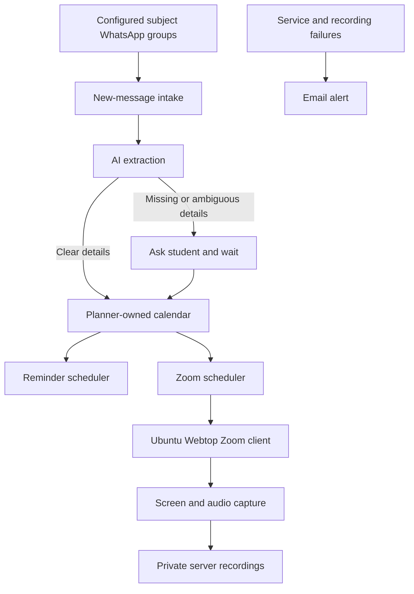

# Student Planner for WhatsApp Classes and Assignments

* **Author:** piragenth-satkunananthan
* **Status:** Approved
* **Date:** 2026-11-08

--------------------------------------------------------------------------------

## Overview

The Student Planner tracks classes and assignments announced in the student's subject WhatsApp groups. It adds lecturer posts to its planner-owned calendar, sends reminders, and is designed to join Zoom classes and record the screen and audio on the user's server. The calendar is available from Android and Arch Linux browsers. Unattended joining, admission, and host-end detection must pass a test meeting before live recording is enabled.

## The Problem

Lecturers post assignment instructions and Zoom links in subject WhatsApp groups. Important details can be missed among group messages, and manually entering every deadline and class into a calendar adds work and can still fail when a post is overlooked. The student needs one place to track those assignments and classes, receive reminders, and capture permitted lectures when they cannot join on time. When a post leaves an important date or class time unclear, the planner should ask the student rather than guess.

## Goals

* Create calendar entries from new, relevant lecturer posts in the student's configured subject groups, including assignment details and Zoom class links.
* Use AI to interpret assignment and class instructions, and ask the student when required information is missing or ambiguous.
* Treat a clear assignment date with no stated time as due at 11:59 PM Sri Lanka time. Remind the student at 9:00 AM Sri Lanka time on the day before and on the due date.
* Remind the student about Zoom classes at 9:00 AM Sri Lanka time the day before and one hour before the class. Ask for the class time when the post does not provide it.
* For a scheduled class, aim to join five minutes before it starts, wait up to 20 minutes for the meeting to open, capture screen and audio, and stop when the host ends the meeting. Report failures so the student can decide what to do next.
* Prove the message intake and unattended Zoom workflow with a test group and host-controlled test meeting before relying on it for live classes.

## Non-Goals

* Support multiple users or overlapping Zoom classes.
* Send messages or replies to subject WhatsApp groups.
* Guess unclear assignment dates or Zoom class times.
* Replace a full learning-management system.
* Support multiple WhatsApp automation libraries in the initial version.

## Open Questions

* **WhatsApp reliability**: Does the Baileys pilot receive new posts, reconnect, and recover after server downtime reliably enough for one live group? If it fails, does whatsapp-web.js pass the same pilot?
* **OpenRouter model quality and availability**: Does a free OpenRouter model pass every synthetic fixture, including field-level evidence checks, and does its selected provider route support JSON mode reliably?
* **Unattended Zoom capture**: Can the Webtop account join and be admitted unattended, capture usable screen and audio, and expose a reliable host-ended state to the worker? This must pass a host-controlled meeting before live recording is enabled.
* **Late assignments**: If an assignment arrives after its due time, create it as `overdue_review`, send no scheduled deadline reminders, and ask the student whether to keep it for reference or archive it.

## Critical User Journeys (CUJs)

### CUJ 1: Track an assignment from a lecturer post

* **Given**: The lecturer is configured as trusted in a subject group, and the assignment post gives a clear due date.
* **When**: The post arrives and the planner extracts its instructions.
* **Then**: The assignment appears in the planner-owned calendar with its source reference. If the post gives a date but no time, the due time is 11:59 PM Sri Lanka time. The planner sends the assignment reminders at 9:00 AM on the day before and on the due date.

### CUJ 2: Resolve an unclear post

* **Given**: A trusted lecturer post is missing a required deadline or Zoom class time, or the extracted details are ambiguous.
* **When**: OpenRouter extraction marks the item for clarification.
* **Then**: The item stays pending, the student sees a question in the planner and receives an email notice, and the item is not scheduled with guessed details. After the student answers, the planner updates the calendar and applicable reminders.

### CUJ 3: Join and record a scheduled Zoom class

* **Given**: A confirmed class item exists, no other lecture is scheduled at the same time, and the tested Webtop worker is healthy.
* **When**: The scheduled join time arrives.
* **Then**: The worker opens the meeting five minutes early, waits up to 20 minutes for it to open, and captures screen and audio after admission. It stops when the host-ended state is detected, or at the four-hour recording cap if that signal is missed, and reports failures by email.

## Technical Plan (Architecture)

The service runs on the user's server and owns the planner calendar. A calendar view in the service makes the assignments and classes available from the user's Android phone and Arch Linux desktop. Both devices use a browser to reach the planner over authenticated HTTPS on the private LAN; remote access requires the user's VPN into that network. Each calendar item keeps a reference to the source WhatsApp message so the student can check where its details came from.

### Message intake and planning

* A WhatsApp intake client watches only new posts in configured subject groups from trusted lecturer senders. The one-group pilot tests Baileys first and tests whatsapp-web.js only if Baileys fails; the live service uses one client. Before enabling live-group intake, the owner checks the current WhatsApp terms and the selected client's current policy, records the check date and account-risk decision, and uses manual forwarding if automated access is not acceptable. If the account is restricted, stop automated intake and alert the user.
* OpenRouter Chat Completions uses one selected lecturer post per request and `response_format: { type: "json_object" }` with `provider.require_parameters: true`. Send the post text, timestamp, `Asia/Colombo`, URL placeholders, and link indexes with Zoom flags. Do not send WhatsApp message IDs, group IDs, sender IDs, actual URLs, or passcodes. The user accepts OpenRouter's selected upstream provider route and its data practices. Choose a free model only after it passes the synthetic comparison; Gemma 4 31B is a candidate, not a fixed choice. Keep Gemini only as the comparison baseline, with no paid, Gemini, or local runtime fallback. Require all expected fields with explicit nulls when unavailable, then enforce the strict local schema, exact field evidence, semantic/date checks, and existing Zoom-link index validation.
* Use the existing event fields `kind`, `title`, `details`, `due_date`, `due_time`, `class_date`, and `class_time`. Add nullable `course`, `location`, `change_type` (`cancelled`, `rescheduled`, or null), and `change_details`. Put unclear fields in `ambiguous_fields`. For every non-null factual field, map its name in `field_evidence` to one or more exact `{ quote }` entries from the single post. Each quote must occur in both the model-visible text and original local post and must support the field and normalized value. The app checks dates and times against the quoted wording and source timestamp in `Asia/Colombo`. The app attaches the original source reference after validation; the model never supplies source identifiers. `zoom_url` is derived locally from the validated link index and needs no model evidence.
* Clear, supported information becomes a planner item. Missing or ambiguous required details stay pending for clarification; do not guess or partially accept an event as confirmed. Keep raw message text only while clarification is pending. Store validated evidence quotes with the event, delete them from the live database when the event is deleted, and do not log them separately. Encrypted backups may retain deleted quotes until the existing seven-daily and four-weekly rotation expires. After raw text is deleted, retain the group, message ID, sender, timestamp, and original-message link if available as provenance; do not reproduce the deleted message body.
* Use a 60-second request timeout and no automatic retries. Treat provider errors, rate limits, empty or malformed responses, schema failures, and invalid evidence as extraction failures. Retain failed posts locally for retry or manual review once the durable planner path exists. Keep live intake disabled until that failure path is implemented; alert the user when extraction fails.
* The planner calendar stores the source item and its reminder state. Assignment and class reminders use the Sri Lanka time rules in the Goals section and remain deduplicated when the service restarts or a post is received again.

### Zoom scheduling and capture

* The Zoom scheduler watches confirmed class items for which permission is confirmed and starts the candidate Ubuntu Webtop desktop workflow five minutes before class.
* The Zoom client waits up to 20 minutes for the meeting to open. Once admitted, a screen and audio capture process saves the recording privately on the server.
* Start capture only when the worker can verify admission through the configured account and host settings and permission for that class is confirmed. Do not bypass blocked controls. If permission or admission cannot be confirmed, do not capture; report the failure and keep unattended recording disabled for that class.
* The capture must stop when the host ends the meeting. The Webtop worker checks the visible Zoom UI for the ended-meeting state and enforces a four-hour cap from recording start if that signal is missed. During capture, check free space at least every 15 seconds and stop and finalize the recording if free space falls below 10 GiB. Send an alert and test this stop condition in the Zoom pilot. If any required step fails, unattended recording stays disabled and the service reports the failure.

### Notifications and data flow

* The service sends scheduled reminders and shows clarification questions in the planner with an email notice. Email is the independent path for service and recording failures so email notices remain available when WhatsApp intake is disconnected, provided SMTP is working.
* Recordings stay on the user's server and can be deleted by the user. At 80% disk use, the service pauses new recordings; during an active capture it also stops and finalizes the file if free space falls below 10 GiB. It sends an email alert instead of deleting older recordings automatically.
* WhatsApp and Zoom session credentials stay out of routine logs. Intake health, pending questions, reminder results, Zoom join and recording outcomes, and available disk space are tracked without logging message text, meeting links, or passcodes.

## Alternatives Considered

### Manual forwarding to a private intake

* **Pros**: You control which messages reach the planner, and forwarding remains a fallback if automatic WhatsApp intake stops working or becomes unacceptable.
* **Cons**: It adds a repeated manual step and can still fail when you overlook a post.
* **Reason for rejection**: Rejected by author as the primary flow because routine forwarding conflicts with the goal of avoiding manual entry; retained as a possible fallback.

### Supporting Baileys and whatsapp-web.js together

* **Pros**: The service could compare both clients or switch if one stops receiving messages.
* **Cons**: It adds a second unofficial client, session, and recovery path to maintain without a stated need.
* **Reason for rejection**: Rejected by author for the initial scope because maintaining two unofficial clients adds work without a stated need; test one client first and use only the one that passes the pilot.

### Zoom's built-in recording controls

* **Pros**: This uses Zoom's own recording feature when the account and meeting settings allow it.
* **Cons**: Host and account controls determine whether recording is available, and recording controls do not solve unattended joining or admission.
* **Reason for rejection**: Rejected by author as the initial capture path because you selected local screen and audio capture in Ubuntu Webtop. Reconsider Zoom recording controls if the meeting settings allow them and they improve reliability.

### Zoom RTMS instead of a meeting-client capture path

* **Pros**: RTMS is Zoom's official media-stream route and avoids recording the full desktop.
* **Cons**: Host and administrator settings control access; an app used outside its Zoom account may require review. Starting a stream also requires an already-joined participant and an available host or alternate host.
* **Reason for not selecting now**: The required account, host, and administrator prerequisites have not been established, and RTMS does not provide the unattended join path by itself. Revisit it if those prerequisites are confirmed.

### An existing calendar account as the event source of truth

* **Pros**: Assignments and classes could appear in a calendar you already use on Android and Arch Linux.
* **Cons**: The planner would depend on that provider's access and synchronization behavior, and the provider would own event updates alongside WhatsApp source tracking.
* **Reason for rejection**: Rejected by author in favor of a planner-owned calendar as the source of truth.

## Non-Functional Requirements

* **Privacy and security**: Read only new posts from configured groups and trusted lecturer senders. Send only selected post text, timestamp, timezone, URL placeholders, and link indexes to OpenRouter. Do not send WhatsApp IDs, actual URLs, or passcodes. OpenRouter may select an upstream provider; its route and data practices apply. Keep message bodies and evidence quotes out of routine logs and email subjects. Store quotes only with validated events, remove them from the live database when the event is deleted, and state that encrypted backups may retain them through the existing seven-daily and four-weekly rotation. Protect WhatsApp/Zoom credentials and backups. Require authenticated HTTPS for planner access. Expose the Webtop interface only on the same private network used by the user's devices, require its own interactive authentication separate from the planner-to-agent token, and restrict terminal and passwordless-sudo access to the user. Do not expose Webtop publicly or mount the container engine socket into the application.
* **Reliability**: Persist message, event, reminder, Zoom job, and recording states so restarts do not silently lose work. Use unique message and reminder keys. Email delivery is at-least-once: a duplicate notice is possible if SMTP accepts a message and the service stops before recording delivery. Persist each attempt and expose delivery status in the planner; do not promise exactly-once SMTP delivery. Send operational alerts through email independently of WhatsApp.
* **Storage and runtime limits**: Stop an individual recording after four hours if no host-ended signal arrives. At 80% disk use, pause new recordings; during active capture, check at least every 15 seconds and stop and finalize the file below 10 GiB free. Preserve existing recordings until the user deletes them. OpenRouter free-route availability and limits can pause extraction; use a 60-second timeout, no automatic retries, and retain failed posts locally for retry or manual review once the durable planner path exists.
* **Rollout**: Use a separate WhatsApp test group and host-controlled Zoom meeting first. Before live-group intake, record the current WhatsApp policy check and account-risk decision. Do not enable live-group intake or unattended recording until the corresponding pilot and authorization checks pass.

## Additional Resources

* [Node.js release schedule](https://nodejs.org/en/about/previous-releases)
* [Baileys installation and requirements](https://github.com/WhiskeySockets/docs/blob/main/installation.mdx)
* [whatsapp-web.js project](https://github.com/wwebjs/whatsapp-web.js/)
* [WhatsApp Terms of Service](https://www.whatsapp.com/legal/terms-of-service)
* [Zoom Linux Meeting SDK guidance](https://developers.zoom.us/docs/meeting-sdk/linux/)
* [Zoom bot controls](https://support.zoom.com/hc/en/article?id=zm_kb&sysparm_article=KB0088381)
* [LinuxServer Webtop documentation](https://docs.linuxserver.io/images/docker-webtop/)
* [OpenRouter Chat Completions](https://openrouter.ai/docs/api/api-reference/chat/create-a-chat-completion)
* [OpenRouter structured outputs](https://openrouter.ai/docs/guides/features/structured-outputs)
* [OpenRouter provider routing](https://openrouter.ai/docs/guides/routing/provider-selection)
* [OpenRouter privacy policy](https://openrouter.ai/privacy)
* [Gemma 4 31B free model candidate](https://openrouter.ai/google/gemma-4-31b-it:free)

## Detailed Implementation Plan

The project has a Node.js 24 TypeScript foundation, a Gemini extraction adapter, and pilot scripts. Extend the existing single-user web service with Fastify, SQLite, and a plain responsive browser interface. Baileys is the first WhatsApp client to test because its stable Node package supports TypeScript and works without a browser; its project documentation requires Node.js 20 or later. If Baileys fails the one-group pilot, test whatsapp-web.js before selecting one client for live intake. The Node.js release table lists version 24 as LTS. [Node.js release schedule](https://nodejs.org/en/about/previous-releases), [Baileys installation](https://github.com/WhiskeySockets/docs/blob/main/installation.mdx), [Baileys project](https://github.com/WhiskeySockets/Baileys)

The planner owns its calendar in SQLite. It sends one selected lecturer post at a time to OpenRouter for JSON extraction, using the free model selected by the synthetic comparison and requiring provider support for requested parameters. The app validates the full response and evidence locally before attaching source provenance. OpenRouter may route the request to an upstream provider, whose data practices apply. If no free model passes, keep extraction and live intake disabled; do not use a paid, Gemini, or local runtime fallback. Keep a failed post locally for retry or manual review once the durable planner path is implemented. Use email for operational failures and clarification notices, and an in-app queue for questions. The Zoom worker runs in a separate Ubuntu Webtop container and communicates with the planner over a private authenticated connection; it has no access to the container engine socket. The Android phone and Arch Linux desktop reach the planner through authenticated HTTPS on the private LAN; access from outside that LAN requires the user's VPN.

### Implementation stages

1. **Feasibility pilot**: Run Gemini and each shortlisted free OpenRouter model on the same synthetic fixtures. Compare every normalized field and evidence quote; require 100% expected-field accuracy, valid evidence for every non-null fact, and zero unsupported or ambiguous items confirmed. Verify JSON mode and `provider.require_parameters: true` on the OpenRouter request. Do not send WhatsApp IDs, group IDs, sender IDs, actual URLs, passcodes, or real WhatsApp posts to model candidates. Use one 60-second attempt with no automatic retry. If no free candidate passes, keep extraction disabled. Connect Baileys to the separate test group only to test intake recovery and filtering; do not send its real posts to any model. Test the Webtop Zoom workflow in a host-controlled meeting: verify permission, login, join, admission, screen and audio capture, the 20-minute opening wait, host-end detection within 30 seconds, the low-space stop, restart behavior, and saved-file verification. A reviewer must confirm both screen and audio are usable in a saved sample. If Baileys fails, try whatsapp-web.js in the same test group. Do not connect a live subject group or enable unattended recording until its corresponding pilot and authorization checks pass.
2. **Planner core**: Build the SQLite store, local message extraction, clarification queue, planner-owned calendar, and persistent reminders. Use `Asia/Colombo`; date-only assignments are due at 11:59 PM, and reminder times follow the Goals section. Store a stable source identity as group ID, message ID, sender ID, and sent timestamp. Planner items have `pending`, `confirmed`, `cancelled`, or `overdue_review` status and retain their source identity. A quoted or replied-to message identifies the item changed or cancelled; without that reference, apply a correction or cancellation only when exactly one open item in that group matches the stated subject and date, otherwise ask the student. A user's corrected field takes precedence over later message edits until the user clears that correction. Repeated delivery of the same message ID is idempotent; identical content under a new ID remains in duplicate review. Keep raw message text only while clarification is pending. If an assignment arrives after its due time, create it as `overdue_review`, send no scheduled deadline reminders, and ask the student whether to keep it for reference or archive it.
3. **User access and alerts**: Serve a password-protected responsive calendar over authenticated HTTPS on the private network. Android and Arch Linux browsers access it on the private LAN; remote access requires the user's VPN. Show pending questions, intake health, class status, source provenance with field evidence quotes, and recording links; let the user answer clarifications and delete recordings. Send reminders and clarification notices by email as well as showing them in the planner; never send messages to class groups.
4. **Zoom worker**: After the feasibility pilot passes, let the scheduler submit one job at a time to the Webtop agent only for a class with confirmed permission. The worker verifies admission through the configured account and host settings and does not bypass blocked controls. It opens the confirmed meeting five minutes before start, waits up to 20 minutes, and starts FFmpeg screen and audio capture after admission. Detect the ended-meeting state from the visible Zoom UI and stop capture then; stop at a four-hour hard limit if that signal is missed. Check free space at least every 15 seconds and stop and finalize capture below 10 GiB free. Save recordings under `/data/recordings`, alert on stop or failure, and do not delete older recordings automatically.
5. **Private pilot and recovery**: Run one subject group and the test meeting through a server restart and an intake outage. Check reminder deduplication, message catch-up, recording recovery, email alerts, private Webtop access, and backup restore before enabling other groups. Create a daily encrypted SQLite online backup, including planner state and recording metadata, on storage separate from the live database; retain seven daily and four weekly copies. Exclude WhatsApp/Zoom credentials and recording video files. Restore by stopping the service, restoring a selected snapshot, and verifying planner items, reminders, and metadata before restart. The pilot must restore a snapshot and confirm these records. Document that video files are not recoverable from this backup and that expired snapshots may contain data deleted from the live database until their retention period ends.

### Target Files to Create or Modify

#### 1. `package.json` (Create)

* **Type / Scope**: Node.js application manifest.
* **Proposed Changes**: Pin Node 24 compatibility and add scripts for build, start, and verification. Add TypeScript, Fastify, static-file serving, SQLite, schema validation, email, and the single WhatsApp client selected by the pilot. Do not include both clients in the live application.

#### 2. `tsconfig.json` (Create)

* **Type / Scope**: TypeScript compiler configuration.
* **Proposed Changes**: Compile the planner and Webtop agent for Node.js 24 using strict type checks and a single `dist/` output tree.

#### 3. `package-lock.json` (Create)

* **Type / Scope**: npm dependency lockfile.
* **Proposed Changes**: Pin the exact dependency versions used by the planner build and deployment so a rebuild uses the same WhatsApp client and runtime libraries.

#### 4. `.gitignore` (Create)

* **Type / Scope**: Git exclusions.
* **Proposed Changes**: Exclude `.env`, WhatsApp session credentials, SQLite databases, generated output, downloaded AI models, and recordings so private runtime data cannot be committed accidentally.

#### 5. `.env.example` (Create)

* **Type / Scope**: Safe configuration example.
* **Proposed Changes**: Document the planner login, private bind address, subject group and lecturer IDs, timezone, OpenRouter API key and selected free model, SMTP settings, internal Webtop token, recording path, 80% storage threshold, 10 GiB active-recording free-space floor, and four-hour recording cap. Use placeholders only.

#### 6. `compose.yaml` (Create)

* **Type / Scope**: Server deployment.
* **Proposed Changes**: Define planner and Ubuntu Webtop services with persistent data volumes. The planner calls OpenRouter over HTTPS; keep Webtop off public ports, restrict service communication to the private container network, and do not mount the container engine socket into the planner.

#### 7. `src/config.ts` (Create)

* **Type / Scope**: Runtime configuration.
* **Proposed Changes**: Load and validate environment settings, default the timezone to `Asia/Colombo`, and fail startup when required secrets or storage paths are missing.

#### 8. `src/db.ts` (Create)

* **Type / Scope**: SQLite storage and migrations.
* **Proposed Changes**: Create tables for source messages, planner items, pending clarifications, reminder deliveries, Zoom jobs, and recording metadata. Store source group ID, message ID, sender ID, and sent timestamp; planner items store their source identity, kind, status, due or class-start time, user-corrected fields, and validated field evidence. Keep evidence quotes with the event and delete them with it; encrypted backups may retain them until the seven-daily and four-weekly rotation expires. Use `pending`, `confirmed`, `cancelled`, and `overdue_review` item states. Enforce unique source-message IDs and unique reminder keys so replay and restart do not create duplicates.

#### 9. `src/whatsapp.ts` (Create)

* **Type / Scope**: WhatsApp linked-device intake.
* **Proposed Changes**: Connect the selected client, accept only new posts from configured subject groups and lecturer IDs, persist the last-seen message reference, expose connection health, and reconnect without logging message bodies or session credentials. Before live intake, record the date of the current WhatsApp policy check and the user's account-risk decision; stop and alert if the account is restricted. Pilot Baileys first; use whatsapp-web.js only if the pilot fails.

#### 10. `src/ai.ts` (Create)

* **Type / Scope**: OpenRouter instruction extraction.
* **Proposed Changes**: Send one selected lecturer post to the selected free OpenRouter model using JSON mode and `provider.require_parameters: true`. Send no WhatsApp identifiers, actual URLs, or passcodes. Require the complete strict schema, exact field evidence, and semantic/date validation locally before creating an item. Keep Gemini only for the synthetic comparison, with no paid, Gemini, or local runtime fallback. Preserve incomplete but valid announcements for clarification; reject unsupported or invalid output.

#### 11. `src/planner.ts` (Create)

* **Type / Scope**: Assignment and class lifecycle.
* **Proposed Changes**: Create and update planner items with source identity, statuses, user corrections, and cancellation handling. Match changes through a quoted/replied-to message, or update only a unique open item matching group, subject, and date; otherwise ask the user. Preserve user-corrected fields until cleared. Deduplicate delivery retries by source message ID and hold identical reposts under new IDs for user review. Convert clear date-only deadlines to 11:59 PM Sri Lanka time; leave unclear items pending and overdue assignments in `overdue_review` without scheduled reminders.

#### 12. `src/reminders.ts` (Create)

* **Type / Scope**: Persistent reminder scheduler.
* **Proposed Changes**: Create assignment reminders for 9:00 AM the day before and due date, and class reminders for 9:00 AM the day before and one hour before. Insert a unique pending delivery before sending, mark it delivered only after SMTP succeeds, and retry pending deliveries after restart; suppress reminders for canceled, unresolved, or `overdue_review` items. Email delivery is at-least-once: duplicate notices are possible if SMTP accepts a message before the service records delivery. Persist attempts and expose delivery status; do not promise exactly-once delivery.

#### 13. `src/notifications.ts` (Create)

* **Type / Scope**: Email and in-app notices.
* **Proposed Changes**: Send reminders, clarification links, and failure alerts through configured SMTP. Keep message text, meeting links, and passcodes out of email subject lines and operational logs.

#### 14. `src/zoom.ts` (Create)

* **Type / Scope**: Zoom job scheduler and state tracking.
* **Proposed Changes**: Schedule confirmed non-overlapping classes with confirmed permission, request a Webtop job five minutes before start, enforce the 20-minute wait, record job state, and alert when the agent fails, cannot verify admission, reaches the four-hour cap, or stops for low disk space.

#### 15. `src/server.ts` (Create)

* **Type / Scope**: Fastify API and application startup.
* **Proposed Changes**: Serve the password-protected browser UI over HTTPS on the private network and accept Webtop agent status over a separate authenticated private connection. The agent claims one job through `POST /agent/jobs/claim`, which returns job ID, planner item ID, meeting link, scheduled start, and lease expiry. It renews a 60-second lease every 20 seconds through `POST /agent/jobs/{job_id}/heartbeat` and reports state through `POST /agent/jobs/{job_id}/status`. Job states are `queued`, `claimed`, `joining`, `waiting`, `recording`, `completed`, `failed`, and `expired`. Requeue an expired lease only if recording has not begun; if it expires after recording starts, mark the job failed for review and reconcile its saved-file state before another capture. Start intake, reminders, and Zoom scheduling from persisted database state.

#### 16. `web/index.html`, `web/app.js`, and `web/style.css` (Create)

* **Type / Scope**: Responsive planner interface.
* **Proposed Changes**: Provide calendar and upcoming-item views, a pending-clarification queue with answer forms, manual correction/cancellation, source provenance showing group, message ID, sender, timestamp, an original-message link if available, and the field evidence quotes, recording links and deletion, and health/failure status for Android and desktop browsers. Do not display deleted raw source text as recoverable.

#### 17. `webtop/Dockerfile` (Create)

* **Type / Scope**: Ubuntu Webtop image.
* **Proposed Changes**: Extend the Ubuntu Webtop image with the Zoom desktop client, Node.js agent runtime, FFmpeg, `xdotool`, and Tesseract for reading the visible meeting-ended state. Keep the Webtop UI on the private network, protect it with separate interactive authentication over HTTPS, and restrict terminal and passwordless-sudo access to the user.

#### 18. `webtop/agent.ts`, `webtop/zoom-ui.ts`, and `webtop/capture.ts` (Create)

* **Type / Scope**: Isolated desktop automation and recording worker.
* **Proposed Changes**: Claim one leased, authorized job from the planner; verify admission through the configured account and host settings without bypassing blocked controls; open the Zoom meeting; capture X11 video and PulseAudio audio with FFmpeg; detect the tested end-of-meeting UI state; and stop at the four-hour cap or below 10 GiB free space, finalizing the file. Report job state and saved-file status to the planner; never accept a second concurrent job.

#### 19. `webtop/root/etc/services.d/zoom-agent/run` (Create)

* **Type / Scope**: Webtop process startup.
* **Proposed Changes**: Start the compiled Zoom agent under the Webtop container's service manager and restart it after a process failure without launching a duplicate capture job.

#### 20. `test/whatsapp.test.ts`, `test/extraction.test.ts`, `test/planner.test.ts`, `test/reminders.test.ts`, and `test/zoom.test.ts` (Create)

* **Type / Scope**: Automated unit tests.
* **Proposed Changes**: Cover group/sender filtering, exact expected extraction fields and values, invalid or ambiguous extraction, confidently wrong dates, Sri Lanka date defaults, edit/cancel/duplicate handling, `overdue_review` reminder suppression, at-least-once email retry behavior, Zoom permission/admission and wait/end/cap/low-space state transitions, and restart recovery using fake messages and a fake Webtop agent. Require zero incorrect or ambiguous fixture items to be auto-confirmed.
* **Proposed Changes**: Cover group/sender filtering, exact expected extraction fields and values, missing or invalid field evidence, unsupported and contradictory values, invalid or ambiguous extraction, confidently wrong dates, Sri Lanka date defaults, edit/cancel/duplicate handling, `overdue_review` reminder suppression, at-least-once email retry behavior, Zoom permission/admission and wait/end/cap/low-space state transitions, and restart recovery using fake messages and a fake Webtop agent. Require 100% expected-field accuracy and zero invalid, unsupported, or ambiguous fixture items to be confirmed.

#### 21. `test/fixtures/lecturer-posts.json` (Create)

* **Type / Scope**: Sanitized extraction examples.
* **Proposed Changes**: Store synthetic posts and expected structured values for clear and ambiguous assignment dates, confidently wrong dates, class links with and without times, edits, cancellations, and duplicate messages. Do not put real class messages, links, or names in the repository.

#### 22. `README.md` (Modify)

* **Type / Scope**: User setup and operations guide.
* **Proposed Changes**: Document deployment, the current WhatsApp policy and account-risk gate, linking the WhatsApp account, configuring trusted groups and senders, setting SMTP and OpenRouter API credentials, the selected free model and upstream-provider data-use notice, evidence quote retention and backup limits, authenticated HTTPS and VPN access, separate Webtop authentication, storage behavior, backup contents/retention/restore and video-file exclusion, test-group acceptance criteria, and recovery after session loss.

### Verification Plan

* **Build**: `npm run build` succeeds on Node.js 24 LTS.
* **Automated checks**: `npm test` passes the unit tests for extraction validation, timezone defaults, source deduplication, reminder idempotency, and Zoom worker state transitions.
* **WhatsApp and AI pilot**: Each synthetic fixture has expected structured fields, normalized values, and exact field evidence. Compare Gemini and shortlisted free OpenRouter models on the same fixtures. Require 100% expected-field accuracy, valid evidence for each non-null fact, and zero malformed, unsupported, ambiguous, or contradictory results confirmed. Verify that OpenRouter sends no group/sender IDs, actual URLs, passcodes, or real WhatsApp posts and requires JSON mode with `provider.require_parameters: true`. Regular automated tests use saved responses, not live model calls. In a separate test group, verify permitted senders, intake recovery, edits, duplicates, and restart behavior without sending real posts to model candidates. Confirm untrusted groups/senders are ignored. Keep live intake disabled until the durable failure and manual-review path exists.
* **Zoom pilot**: In a host-controlled test meeting with confirmed permission, verify admission through the configured account and host settings, the 20-minute wait and leave behavior, a saved sample with usable screen and audio, host-ended detection within 30 seconds, the low-space stop, four-hour cutoff signaling, saved-file verification, and restart behavior. Keep the Webtop UI private.
* **Data handling**: Verify raw text is removed after clarification, evidence quotes remain attached to events and are deleted with them, encrypted backups may retain deleted quotes through the seven-daily and four-weekly rotation, source provenance remains without reproducing deleted raw text, credentials and links do not appear in routine logs, recordings remain private and user-deletable, low-space capture finalizes safely, and a daily encrypted SQLite backup restores planner state and recording metadata. Verify retention and that video files are excluded from backups.
* **Release gate**: Enable live WhatsApp intake only after recording the current policy check and account-risk decision and passing its pilot. Enable unattended recording only after confirming class permission and passing the Zoom pilot. If a check, host-end detection, admission, or audio capture fails, keep the affected automation disabled and report the limitation.

--------------------------------------------------------------------------------

*Drafted with EGM*
